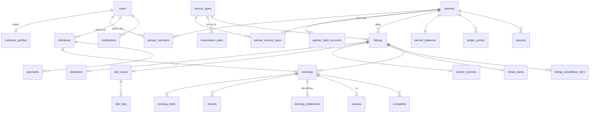

# LunaIn Travel — Thiết kế Database (PostgreSQL)

- Ngày: 2026-11-04
- Spec gốc: [2026-11-04-lunain-travel-backend-design.md](2026-11-04-lunain-travel-backend-design.md). Tài liệu này chi tiết hóa mục 5–9 của spec thành bảng, cột và ràng buộc. Chỗ nào hai tài liệu khác nhau thì spec gốc là chuẩn, và tài liệu này phải được sửa theo.
- Thuật ngữ: [GLOSSARY.md](../../../GLOSSARY.md)
- Ký hiệu: **[Chốt]** = đã có trong spec hoặc đã làm ở plan 1. **[Builder]** = quyết định thiết kế DB mới, cần chủ dự án xem.
- Trạng thái từng nhóm bảng: ✅ đã có (plan 1) · 🔜 plan sẽ làm (số plan theo [lộ trình](../plans/README.md))

---

## 1. Quy ước chung

| Mục | Quy ước |
|---|---|
| Khóa chính | `uuid` v7 sinh trong Go. Ngoại lệ: bảng danh mục dùng mã tự nhiên (`provinces.code`, `service_types.code`) |
| Thời gian | `timestamptz` (UTC). Ngày nghiệp vụ dùng `date`, giờ trong ngày dùng `time`, cả hai hiểu theo giờ `Asia/Ho_Chi_Minh` |
| Cột chuẩn | Mọi bảng có `created_at timestamptz NOT NULL DEFAULT now()` và `updated_at timestamptz NOT NULL DEFAULT now()`. Thời gian nghiệp vụ lấy từ clock của app, không dùng `now()` |
| Tiền | `bigint` VND (đồng). Số tiền bán ra `CHECK (x >= 0)`. Chỉ cột trong sổ cái mới có dấu |
| Tỷ lệ | Basis points `int CHECK (x BETWEEN 0 AND 10000)` (10% = 1000) |
| Enum | `text` + `CHECK (col IN (...))`, giống plan 1. Thêm giá trị bằng migration sửa CHECK, không dùng kiểu `ENUM` của Postgres vì khó đổi |
| Xóa | Không xóa cứng dữ liệu nghiệp vụ, chỉ đổi trạng thái. Ngoại lệ là dữ liệu xác thực (`user_identities` khi đặt lại mật khẩu) |
| Khóa ngoại | Có FK giữa các module để DB giữ toàn vẹn dữ liệu. Code của module chỉ đọc bảng của chính nó (spec §4). Không có `ON DELETE CASCADE` |
| Làm tròn **[Builder]** | `commission_amount = round_half_up(gross_amount × rate_bps / 10000)`, tương tự cho `refund_amount`. Tính bằng số nguyên trong Go, không dùng float |

### 1.1 Thứ tự khóa toàn hệ thống **[Builder]**

Plan 1 đã có quy tắc "user trước, dòng phụ thuộc sau". Khi một transaction chạm nhiều module thì luôn khóa theo thứ tự này, để không bao giờ deadlock:

```
users → partners → listings
      → dòng sức chứa: ride_trips / rental_vehicle_models (theo id tăng dần)
      → checkouts → bookings (theo id tăng dần)
      → dòng con của booking: booking_*_details, booking_settlements, refunds
      → payments → payouts → partner_balances (theo partner_id tăng dần)
```

- Dòng `users` khóa bằng `FOR NO KEY UPDATE`, để không chặn việc insert các bảng có FK trỏ về `users`.
- Dòng `partners` cũng khóa bằng `FOR NO KEY UPDATE` (giống `users`), không dùng `FOR UPDATE`: mỗi lệnh insert vào bảng có FK trỏ về `partners` (`partner_members`, `partner_service_types`, `partner_bank_accounts`, sau này `listings`, `bookings`, ...) ngầm lấy `KEY SHARE` trên dòng đối tác, và `FOR UPDATE` sẽ chặn nó. `FOR NO KEY UPDATE` vẫn xung đột với `FOR SHARE` nên vẫn xếp hàng được với booking.
- Khi tạo booking hoặc xác nhận lại do tiền về trễ, transaction phải lấy `FOR SHARE` trên dòng `partners` và `listings`. Nhờ vậy, một lệnh đình chỉ đối tác hoặc ẩn Listing commit cùng lúc sẽ được xếp hàng, không bị lọt booking.
- **Lịch của đối tác và booking** (plan 4): khi đối tác thêm ngày nghỉ hoặc sửa khung giờ, transaction khóa dòng `listings` bằng `FOR NO KEY UPDATE` rồi mới đếm booking đang hiệu lực (`BookingGuard`). Đổi lịch (reschedule) không cần Listing còn bán được, nhưng vẫn lấy `FOR SHARE` trên dòng `listings` trước khi đọc khung giờ. Hai mức khóa này xung đột nhau, nên booking hoặc đã commit trước phép đếm, hoặc phải chờ rồi đọc lịch mới.
- Dòng `payments` khóa bằng `FOR NO KEY UPDATE`, không dùng `FOR UPDATE`: mỗi lệnh insert vào `payment_events` ngầm lấy `KEY SHARE` trên payment qua FK, và `FOR UPDATE` sẽ chặn nó (đã gặp deadlock thật). Mọi transaction khóa payment đều đã khóa `checkouts` trước, nên chúng vẫn xếp hàng theo checkout.
- **Hợp đồng `Status(lock)` trước `IsServiceTypeEnabled`**: `partner.IsServiceTypeEnabled` tự nó không khóa gì. Muốn an toàn với `Suspend` và `DisableServiceType` (cả hai đều khóa dòng `partners` `FOR NO KEY UPDATE`), phải gọi `partner.Status(ctx, tx, id, true)` (lấy `FOR SHARE`) **trước**, trong cùng transaction. Có test khóa hợp đồng này (`internal/partner/lock_test.go`).
- Dòng sức chứa đứng **trước** booking. Hủy chuyến, job hết hạn và tạo booking mới đều khóa chuyến hoặc mẫu xe trước. Nếu chỉ biết id booking thì đọc id của chuyến hoặc mẫu xe mà không khóa, khóa chuyến hoặc mẫu xe, rồi mới khóa booking và kiểm tra lại trạng thái.
- ✅ Plan 6: **khóa chuyến trước mọi checkout có xe tuyến**. Trừ các ngoại lệ bên dưới, mọi transaction khóa một checkout có booking xe tuyến đều khóa trước các chuyến của checkout đó (theo id tăng dần): tạo booking, job hết hạn, `HandlePaid` (kể cả xác nhận lại khi tiền về trễ), khách hủy, Super Admin hủy đơn và hủy chuyến. Nếu sau khi khóa mà checkout hóa ra có thêm chuyến chưa khóa (đơn vừa được xác nhận giữa chừng) thì transaction rollback và chạy lại.
  - **Ngoại lệ đã biết** (đều không deadlock):
    - Đổi hoặc phát lại link thanh toán (`payment.ReissueAfterMismatch`, `replaceLostLink`) khóa checkout xe tuyến mà **không** khóa chuyến. An toàn vì các đường này không đụng ghế và **không bao giờ chờ khóa chuyến** khi đang giữ checkout. Code sau này cũng không được thêm bước chờ chuyến vào đây.
    - Nhả giữ chỗ quá hạn ngay trong transaction (`releaseOverdueOnTrips`, khi tạo booking hoặc `HandlePaid`) đang giữ một số chuyến thì có thể khóa checkout của **khách khác** có booking trên các chuyến đó. Lúc ấy nó chưa giữ hết các chuyến của checkout kia, và có thể khóa checkout kia trước checkout của chính mình. An toàn vì: (1) mọi đường khác khóa checkout xe tuyến đều đã khóa ít nhất chuyến chung đó trước (theo id tăng dần), nên phải xếp hàng sau transaction này; (2) giữa các checkout thứ tự khóa tùy ý cũng không sao, vì không ai tới được các checkout đó mà không qua chuyến chung đang bị giữ. Chiều kia của đơn khứ hồi nằm trên chuyến chưa khóa thì để job hết hạn xử lý.
- ✅ Plan 7: **khóa mẫu xe trước mọi checkout có thuê xe**. Mọi transaction khóa một checkout có booking thuê xe đều khóa trước dòng `rental_vehicle_models` của booking đó (`FOR UPDATE`, theo id tăng dần): tạo yêu cầu, đối tác chấp nhận hoặc từ chối, khách rút yêu cầu, job `ExpireRequests`, job `ExpireHolds`, `HandlePaid` (kể cả xác nhận lại khi tiền về trễ), hủy đơn. Các transaction chỉ khóa booking mà làm đổi việc giữ xe (đối tác bấm nhận lại xe hoặc No-show, job `FinishRentals`) cũng khóa mẫu xe trước booking: đọc `vehicle_model_id` không khóa (cột này không bao giờ đổi), khóa mẫu xe, rồi khóa booking và kiểm tra lại trạng thái. Giao xe bằng QR (`confirmed → in_service`) không đổi việc giữ xe nên không khóa mẫu xe. Đối tác sửa `quantity` khóa listing rồi mẫu xe trước khi đếm xe đang giữ (mục 5.7).
  - Một checkout chỉ có một loại dịch vụ. Nếu sau này một checkout có cả xe tuyến và thuê xe thì khóa `ride_trips` trước `rental_vehicle_models`.
  - Hai ngoại lệ của plan 6 (`ReissueAfterMismatch`, `replaceLostLink` khóa checkout mà không khóa sức chứa) cũng áp cho thuê xe, với cùng lý do: không đụng xe và không bao giờ chờ khóa mẫu xe khi đang giữ checkout.
- Dòng con của booking (`booking_settlements`, `refunds`, ...) chỉ được khóa sau khi đã khóa dòng `bookings`. Job giải phóng tiền cũng phải khóa booking trước.
- Các dòng khác khóa bằng `FOR UPDATE`.

### 1.2 Toàn vẹn chéo đối tác **[Builder]**

Để một lỗi ở app không thể gắn dữ liệu của đối tác này vào đối tác khác, DB tự ràng buộc bằng **khóa ngoại kép**:

- `listings` có `UNIQUE(id, partner_id)`. `bookings` có FK `(listing_id, partner_id) → listings(id, partner_id)` và `UNIQUE(id, partner_id)`.
- Mỗi bảng catalog con có `UNIQUE(id, listing_id)`: `attraction_ticket_types`, `attraction_time_slots`, `ride_trips`, `charter_vehicle_classes`, `rental_vehicle_models`, `rental_pickup_points`.
- Bảng chi tiết của booking có thêm `listing_id` và FK kép tới catalog con, ví dụ `booking_ride_details (trip_id, listing_id) → ride_trips(id, listing_id)`. Chiều về của khứ hồi là một booking riêng trên listing tuyến ngược, nên vẫn khớp.
- Các bảng mang `partner_id` cùng một booking (`booking_settlements`, `ledger_entries`, `reviews`, `complaints`) có FK `(booking_id, partner_id) → bookings(id, partner_id)`.

---

## 2. Sơ đồ quan hệ tổng quát



Bảng chi tiết theo từng loại dịch vụ (`attraction_*`, `ride_*`, `charter_*`, `rental_*`, `booking_*_details`) nằm ở mục 5 và mục 6.

---

## 3. Identity ✅ (plan 1)

Đã có trong migration `00002`–`00004`: `users`, `user_identities`, `email_verifications`, `refresh_tokens`, `customer_profiles`. Plan sau chỉ thêm một bảng:

| Bảng | Cột | Ghi chú |
|---|---|---|
| `customer_refund_accounts` ✅ plan 4 (migration `00013`) | `user_id` PK FK users, `bank_bin text` (`^[0-9]{6}$`), `account_number text` (`^[0-9]{6,19}$`), `account_holder text` (không rỗng; từ plan 5, migration `00016`, thêm CHECK `^[A-Z]+( [A-Z]+)*$`) | Tài khoản nhận hoàn khách lưu sẵn (spec §6.3) |

---

## 4. Nền tảng dùng chung 🔜 plan 2

### `platform_settings` **[Builder]**: các thông số Super Admin chỉnh được

Bảng chỉ có một dòng (`id smallint PRIMARY KEY CHECK (id = 1)`). Mỗi thông số là một cột có kiểu và CHECK riêng, không dùng dạng key–value, để DB tự chặn giá trị sai.

| Cột | Kiểu | Mặc định | Nguồn trong spec |
|---|---|---|---|
| `hold_minutes` | int > 0 | 15 | §6.1 |
| `hold_grace_minutes` | int ≥ 0 | 5 | §7 |
| `request_response_hours` | int > 0 | 12 | §6.2 |
| `request_payment_hours` | int > 0 | 2 | §6.2 |
| `charter_late_confirm_min_hours` | int ≥ 0 | 3 | §8 |
| `ride_checkin_window_minutes` | int > 0 | 60 | §10 (±X quanh giờ khởi hành) |
| `ride_no_show_after_minutes` | int ≥ 0 | 60 | §6.1 |
| `charter_auto_complete_hours` | int > 0 | 24 | §6.2 |
| `release_delay_days` | int ≥ 0 | 1 | §9 |
| `min_payout_amount` | bigint ≥ 0 | 100000 | §9 **[Builder]** chọn số |
| `reschedule_window_days` | int > 0 | 14 | §6.4 **[Chốt]** |
| `ride_booking_cutoff_minutes` ✅ plan 6 (migration `00017`) | int ≥ 0 | 60 | **[Chốt]** hạn chót đặt xe tuyến: chỉ đặt (và tìm thấy) được chuyến có `departure_at > now + max(ride_booking_cutoff_minutes, hold_minutes + hold_grace_minutes)`, nên hạn chót không bao giờ ngắn hơn thời gian giữ chỗ |

Mỗi lần đổi đều ghi vào `admin_audit_log`. Booking không trỏ tới bảng này mà chụp lại các mốc thời gian đã tính sẵn lúc tạo (`hold_expires_at`, ...), nên đổi thông số không ảnh hưởng đơn cũ.

### `holidays`: ngày lễ cho phụ phí xe bao chuyến
`date date PRIMARY KEY`, `name text NOT NULL`.

### `files`: mọi file tải lên (ảnh, giấy phép, chứng từ)
| Cột | Kiểu | Ghi chú |
|---|---|---|
| `id` | uuid PK | |
| `storage_key` | text UNIQUE NOT NULL | khóa trên object storage tương thích S3 |
| `content_type` | text NOT NULL | chỉ nhận ảnh và PDF, kiểm tra ở app |
| `size_bytes` | bigint > 0 | |
| `visibility` | `public` \| `private` | giấy phép và chứng từ luôn là `private` |
| `uploaded_by` | uuid FK users | |

### `admin_audit_log`
`id`, `actor_user_id` FK users, `action text` (ví dụ `commission_rate.create`, `listing.hide`), `target_kind text`, `target_id uuid`, `before jsonb`, `after jsonb`, `reason text`, `created_at`. Index `(target_kind, target_id, created_at DESC)`.

Plan 5 ghi audit trong cùng transaction với mọi thao tác admin lên tiền hoặc trạng thái: `payout.approve`, `payout.mark_paid`, `payout.reject`, `ledger.adjustment`, `refund.complete`, `payment.review_seen`, `payment.review_resolve`, `reconciliation.run` (chỉ khi admin bấm chạy tay; job theo lịch không ghi). Bảng này cũng ghi thao tác **đổi tài khoản ngân hàng của đối tác** (`partner.bank_account.set`), với `actor_user_id` là **user đối tác** đã đổi, không phải admin: tài khoản nhận tiền là dữ liệu nhạy cảm nên mọi lần đổi phải truy được.

### Danh mục địa giới (spec §5.4)
- `provinces`: `code text PK` (mã chính thức), `name`, `slug UNIQUE`, `sort_order`.
- `wards`: `code text PK`, `province_code` FK, `name`, `slug`, `UNIQUE(province_code, slug)`.

Dữ liệu là 34 tỉnh/thành sau sáp nhập 2025, không còn cấp huyện. Import bằng một migration seed.

---

## 5. Partner và Catalog

### 5.1 Đối tác 🔜 plan 2

**`partners`**
| Cột | Kiểu | Ghi chú |
|---|---|---|
| `id` | uuid PK | |
| `legal_name` | text NOT NULL | tên trên giấy phép kinh doanh |
| `display_name` | text NOT NULL | tên hiển thị cho khách |
| `tax_code` | text NULL UNIQUE | đối tác tự cập nhật |
| `business_license_file_id` | uuid NULL FK files | file `private` |
| `address`, `province_code`, `ward_code` | | `province_code` FK `provinces`; FK kép `(ward_code, province_code) → wards(code, province_code)` (`wards` có `UNIQUE(code, province_code)`); CHECK tỉnh và phường cùng NULL hoặc cùng có |
| `contact_name`, `contact_phone`, `contact_email` | text | |
| `status` | `active` \| `suspended` | **[Chốt]** spec §5.2 |
| `suspended_at`, `suspended_reason` | | CHECK `(status = 'suspended') = (suspended_at IS NOT NULL)`; đang đình chỉ thì `suspended_reason` NOT NULL |
| `rating_sum int`, `rating_count int` | ≥ 0 | điểm trung bình = sum/count, không lưu số thực |
| `created_by` | uuid FK users | Super Admin tạo |

- **`partner_members`**: `partner_id` FK, `user_id` FK **UNIQUE**, `role` (`owner`), PK `(partner_id, user_id)`. **[Builder]** Mỗi user thuộc tối đa một đối tác.
- **`partner_bank_accounts`**: `id`, `partner_id`, `bank_bin`, `bank_name`, `account_number`, `account_holder`, `is_current bool`, cùng unique index `(partner_id) WHERE is_current`. Đổi tài khoản thì thêm dòng mới và tắt `is_current` của dòng cũ, để giữ lịch sử. Plan 5 (migration `00015`) thêm `created_by uuid NULL FK users` (NULL với các dòng cũ hơn migration) và CHECK `account_holder ~ '^[A-Z]+( [A-Z]+)*$'` (tên in hoa không dấu như trên thẻ). Mỗi lần đổi ghi `admin_audit_log` (mục 4).
- **`partner_service_types`**: PK `(partner_id, service_type)`, `enabled_by`, `enabled_at`, `disabled_at NULL`. **[Chốt]** Super Admin bật từng loại dịch vụ cho từng đối tác.

### 5.2 Loại dịch vụ và hoa hồng 🔜 plan 2

- **`service_types`**: `code text PK` (`attraction_ticket`, `scheduled_ride`, `private_charter`, `self_drive_rental`), `name`, `booking_mode` (`instant` \| `request`), `sort_order`. Seed bằng migration.
- **`commission_rates`**: `id`, `service_type` FK, `rate_bps` 0..10000, `effective_from timestamptz`, `created_by`, `UNIQUE(service_type, effective_from)`. Tỷ lệ đang áp dụng là dòng có `effective_from` lớn nhất mà ≤ thời điểm hiện tại. Không sửa dòng cũ.

### 5.3 Listing lớp chung 🔜 plan 3

**`listings`**
| Cột | Kiểu | Ghi chú |
|---|---|---|
| `id` | uuid PK | |
| `partner_id` | FK partners | |
| `service_type` | FK service_types | app kiểm tra loại này đã được bật cho đối tác |
| `title`, `slug` UNIQUE, `summary`, `description` | text | |
| `cover_file_id` | FK files NULL | |
| `province_code`, `ward_code`, `address` | | |
| `latitude`, `longitude` | `numeric(9,6)` NULL | |
| `review_status` | `draft` \| `pending_review` \| `approved` \| `rejected` | **[Chốt]** chỉ duyệt lần đầu |
| `rejection_reason`, `submitted_at`, `reviewed_at`, `reviewed_by` | | |
| `visibility` | `published` \| `unpublished_by_partner` \| `hidden_by_admin` | |
| `hidden_reason`, `hidden_at`, `hidden_by` | | |
| `rating_sum`, `rating_count` | int ≥ 0 | |

Index:
- `(partner_id)`
- index tìm kiếm cho khách: `(service_type, province_code) WHERE review_status = 'approved' AND visibility = 'published'`
- **[Builder]** index trigram `pg_trgm` trên `lower(unaccent(title))` để tìm không dấu. `unaccent` không phải hàm IMMUTABLE, nên bọc trong một hàm wrapper IMMUTABLE.

Bảng phụ:
- **`listing_images`**: `id`, `listing_id`, `file_id`, `sort_order`, `UNIQUE(listing_id, sort_order)`.
- **`listing_cancellation_tiers`** **[Builder]**: các mốc gắn thẳng vào listing, không cần bảng "policy" trung gian. Cột: `id`, `listing_id`, `hours_before int ≥ 0`, `refund_bps` 0..10000, `UNIQUE(listing_id, hours_before)`. Booking chụp lại toàn bộ các mốc vào `cancellation_policy_snapshot`.
- **`listing_audit_log`**: `id`, `listing_id`, `actor_user_id`, `action`, `changes jsonb` (`{field: {old, new}}`), `created_at`. **[Chốt]** spec §5.4.

### 5.4 Vé tham quan 🔜 plan 3

| Bảng | Cột chính | Ràng buộc |
|---|---|---|
| `attractions` | `listing_id` PK FK, `opening_note`, `checkin_instructions` | 1-1 với listing |
| `attraction_ticket_types` | `id`, `listing_id`, `name`, `description`, `audience` (`child`\|`adult`), `price bigint > 0`, `active`, `sort_order` | **[Chốt]** đối tác tự đặt tên và giá |
| `attraction_time_slots` | `id`, `listing_id`, `start_time time`, `end_time time`, `weekdays smallint`, `active` | `end_time > start_time`. `weekdays` là bitmask 1..127 (bit 0 = thứ Hai) **[Builder]** |
| `attraction_closed_dates` | PK `(listing_id, date)`, `reason` | |

### 5.5 Xe tuyến cố định ✅ plan 6 (migration `00017`)

**[Builder]** Mỗi listing là **một tuyến một chiều** A→B, đúng theo glossary. Chiều về B→A là một listing khác của cùng nhà xe. Khi đặt khứ hồi, khách chọn chuyến về từ listing tuyến ngược lại. **[Chốt]** "Tuyến ngược" so theo tỉnh: tỉnh đi của chiều về là tỉnh đến của chiều đi và ngược lại; phường tự do.

| Bảng | Cột chính | Ràng buộc |
|---|---|---|
| `ride_routes` | `listing_id` PK FK listings, `origin_province_code`, `origin_ward_code`, `origin_name`, `origin_address`, `dest_*` (tương tự), `duration_minutes` 1..4320, `vehicle_description` | tên, địa chỉ và mô tả xe không rỗng. FK kép `(origin_ward_code, origin_province_code)` và `(dest_ward_code, dest_province_code) → wards(code, province_code)`. Index `(origin_province_code, dest_province_code)` |
| `ride_schedules` | `id`, `listing_id` FK `ride_routes`, `departure_time time`, `weekdays smallint` 1..127 (bit 0 = thứ Hai), `seat_capacity > 0`, `price_per_seat > 0`, `valid_from date`, `valid_to date NULL`, `active`, `generated_until date NULL` | lịch lặp để sinh chuyến. `valid_to ≥ valid_from`. `UNIQUE(id, listing_id)` làm đích cho FK kép từ `ride_trips`. `generated_until` là ngày VN cuối cùng job sinh chuyến đã phủ |
| `ride_trips` | `id`, `listing_id` FK `ride_routes`, `schedule_id NULL` (NULL: chuyến lẻ đối tác tự thêm), `departure_at timestamptz`, `seat_capacity int > 0`, `seats_reserved int`, `price_per_seat > 0`, `status` (`scheduled`\|`cancelled`\|`departed`), `cancelled_reason`, `cancelled_at`, `cancelled_by NULL` FK users, `cancel_source` (`partner`\|`admin`\|`schedule`) | `CHECK (seats_reserved BETWEEN 0 AND seat_capacity)`, `UNIQUE(listing_id, departure_at)`, `UNIQUE(id, listing_id)`. FK kép `(schedule_id, listing_id) → ride_schedules(id, listing_id)`. `cancelled_at` có đúng khi `status = 'cancelled'`, đi cùng `cancel_source` và `cancelled_reason`. Index `(departure_at) WHERE status = 'scheduled'` cho tìm chuyến, `(schedule_id, departure_at)` cho job sinh chuyến |

`cancel_source`: `partner` là đối tác hủy chuyến (chỉ khi `seats_reserved = 0`), `admin` là Super Admin hủy chuyến (`cancelled_by` là admin), `schedule` là chuyến bị hủy vì lịch không còn phủ nó (lịch tắt hoặc rút ngắn `valid_to`; `cancelled_by` là đối tác sửa lịch, NULL khi job quét). Chỉ chuyến `schedule` mới được job sinh chuyến mở lại khi lịch phủ lại ngày đó; chuyến đối tác hoặc admin đã hủy thì giữ nguyên. Trạng thái `departed` chưa có job nào ghi (điều kiện `departure_at > now` đã chặn bán ghế), để dành cho báo cáo.

**Sinh chuyến** **[Chốt]**: job River chạy mỗi giờ và một lần lúc khởi động (`RunOnStart`), sinh chuyến cho **60 ngày** tới (hằng số `tripHorizonDays`) theo ngày VN của `departure_at`. Tạo hoặc sửa lịch cũng sinh ngay. Sửa lịch không đổi được `departure_time`, `weekdays`, `valid_from`; giá, sức chứa, `valid_to`, `active` chỉ áp cho chuyến tương lai chưa có ghế được giữ. Job cũng hủy (`cancel_source = 'schedule'`) các chuyến tương lai còn `seats_reserved = 0` mà lịch không còn phủ, trừ khi một lịch đang hoạt động khác phủ đúng giờ đó.

**Một lịch đang hoạt động cho mỗi khung giờ** **[Builder]**: hai lịch `active` của cùng listing không được trùng nhau (cùng `departure_time`, có thứ chung và khoảng ngày giao nhau). Bất biến này **chỉ do app giữ** (`checkScheduleOverlap`, chạy khi đang khóa dòng `listings`), DB không có ràng buộc. Mọi đường bật lịch sau này (kể cả của admin) phải gọi lại hàm này.

Giữ ghế dùng lệnh `UPDATE ride_trips SET seats_reserved = seats_reserved + n WHERE id = $1 AND status = 'scheduled' AND departure_at > $now AND seats_reserved + n <= seat_capacity` (spec §7), rồi kiểm tra số dòng bị ảnh hưởng. Không bán ghế cho chuyến đã hủy hoặc đã chạy. Mỗi lần giữ hoặc trả ghế, `n` phải nằm trong **1..1000** (chặn tràn số `int`, không phải trần nghiệp vụ: khách nhập số khách và chỉ bị giới hạn bởi số ghế còn trống). Khứ hồi giữ cùng số ghế ở hai chiều. Ghế chỉ trả lại khi booking `expired` hoặc `cancelled`, trong cùng transaction đổi trạng thái; `checked_in`, `completed`, `no_show` vẫn giữ ghế.

Trước khi giữ ghế, transaction đã khóa chuyến **[Builder]**. Ngay lúc đó nó nhả luôn ghế của các booking trên chuyến này đã quá `hold_release_at` mà job chưa quét tới. Spec §7 yêu cầu đơn quá hạn không được chiếm chỗ, mà bộ đếm `seats_reserved` không tự bỏ qua được đơn quá hạn, nên phải nhả ngay trong transaction.

**[Builder]** Trigger `ride_trips_booked_immutable` (`BEFORE UPDATE`) chặn sửa `departure_at` và `price_per_seat` khi `seats_reserved > 0` (raise `ride_trip_booked`). App kiểm tra trước và trả lỗi rõ ràng; trigger là lưới an toàn. Đối tác không đổi được giờ của chuyến đã có người đặt, phù hợp với quy tắc đối tác không hủy được đơn đã xác nhận, và không giảm được `seat_capacity` xuống dưới `seats_reserved`. Muốn đổi thì nhờ Super Admin hủy chuyến.

### 5.6 Xe bao chuyến 🔜 plan 8

| Bảng | Cột chính |
|---|---|
| `charter_services` | `listing_id` PK, `max_distance_km numeric(7,1) NULL`, `night_start time NULL`, `night_end time NULL` |
| `charter_service_areas` | PK `(listing_id, province_code)` |
| `charter_vehicle_classes` | `id`, `listing_id`, `name`, `seats > 0`, `base_fare ≥ 0`, `price_per_km ≥ 0`, `active` |
| `charter_surcharges` | `id`, `vehicle_class_id`, `kind` (`night`\|`weekend`\|`holiday`\|`round_trip_waiting`), `calc` (`fixed`\|`percent`), `amount bigint ≥ 0` (VND nếu `fixed`, bps nếu `percent`), `active`, `UNIQUE(vehicle_class_id, kind)` |

**[Chốt]** Phụ phí nào không có dòng thì bằng 0đ.

### 5.7 Thuê xe tự lái ✅ plan 7 (migration `00018`)

| Bảng | Cột chính | Ràng buộc |
|---|---|---|
| `rental_stores` | `listing_id` PK FK listings, `handover_open time`, `handover_close time`, `delivery_available bool`, và các điều khoản dạng text NULL: `deposit_terms`, `documents_terms`, `late_fee_terms`, `allowed_area_terms`, `other_terms` | `CHECK (handover_close > handover_open)`: giờ giao nhận tính theo giờ VN, không có khung qua đêm. Cửa hàng không có cột vị trí riêng: địa chỉ cửa hàng là `listings.province_code/ward_code/address`, và listing thuê xe vẫn phải có đủ ba mục này khi gửi duyệt. `delivery_available` được lưu nhưng chưa dùng (không có giao xe tới địa chỉ tự do) |
| `rental_vehicle_models` | `id`, `listing_id` FK `rental_stores`, `vehicle_kind` (`car`\|`motorbike`), `name`, `model_year smallint` 1950..2100, `seats` 1..50, `included_items text NULL`, `tags text[]` (tối đa 10), `price_per_day bigint > 0`, `quantity int ≥ 0`, `cover_file_id NULL` FK files, `active` | `name` không rỗng. `UNIQUE(id, listing_id)` làm đích cho FK kép từ `booking_rental_details`. Index `(listing_id)` |
| `rental_pickup_points` | `id`, `listing_id` FK `rental_stores`, `name`, `address`, `province_code`, `ward_code`, `delivery_fee bigint ≥ 0`, `active` | `name`, `address` không rỗng. FK kép `(ward_code, province_code) → wards(code, province_code)`. `UNIQUE(id, listing_id)`. Index `(listing_id)` |

**Điểm nhận xe** **[Chốt]** (plan 7): khách **bắt buộc** chọn một điểm nhận đang hoạt động trong danh sách của đối tác. Mỗi điểm có `delivery_fee` riêng, tính **một lần** cho cả đơn. Khách trả xe tại chính điểm đó. Không có địa chỉ giao tự do, nên `booking_rental_details` có `pickup_point_id NOT NULL` và không có cột `delivery_address` (mục 6).

**Đếm xe theo đỉnh sử dụng cùng lúc** **[Chốt]** (plan 7): khi đang giữ khóa `rental_vehicle_models FOR UPDATE`, hệ thống tính `peak` = số đơn đang giữ xe cùng lúc nhiều nhất tại một thời điểm bất kỳ trong [giờ nhận, giờ trả). Đơn mới được nhận khi `peak + 1 ≤ quantity`. Không đếm thô số đơn có khoảng giao nhau, vì cách đó từ chối oan. Ví dụ: `quantity = 2`, A [T2, T3), B [T4, T5), yêu cầu [T2, T5) → `peak = 1` → nhận; A [T2, T4), B [T3, T5), yêu cầu [T3, T4) → `peak = 2` → từ chối. Một hàm duy nhất (`peakRentalHolds` trong booking, `BookingGuard.RentalPeakHeld` cho listing) dùng cho: tạo yêu cầu, xác nhận lại khi tiền về trễ, tìm kiếm (`units_left = quantity − peak`, mẫu hết xe không hiện) và chặn giảm `quantity`.

**Chặn giảm số lượng** **[Builder]**: đối tác không giảm được `quantity` xuống dưới đỉnh sử dụng cùng lúc trong [now, ∞) (lỗi 409 `quantity_below_held`). Transaction khóa mẫu xe trước khi đếm, nên không lọt đơn mới chen vào giữa.

**Ngày thuê và giờ giao nhận** **[Chốt]**: `days = ceil((return_at − pickup_at) / 24h)`, 1..30 ngày (24h00 là 1 ngày, 24h01 là 2 ngày). Giờ nhận trong vòng 180 ngày tới. Giờ nhận và giờ trả phải tròn phút và nằm trong giờ giao nhận của cửa hàng theo giờ VN, tính cả hai biên. Giá: `gross = price_per_day × days + delivery_fee` của điểm nhận; `booking_items` có một dòng `rental_day` (`quantity = days`) và, nếu phí > 0, một dòng `delivery_fee`. Hoa hồng tính trên toàn bộ `gross`.

---

## 6. Booking 🔜 plan 4 (lớp chung + vé tham quan), plan 6–8 (các loại xe)

### `checkouts`: một lần khách thanh toán
| Cột | Kiểu | Ghi chú |
|---|---|---|
| `id` | uuid PK | |
| `code` | text UNIQUE | `CO` + 8 ký tự Crockford base32, có CHECK regex |
| `customer_id` | FK users | `UNIQUE(id, customer_id)` làm đích cho FK kép từ `bookings` |
| `total_amount` | bigint ≥ 0 | = tổng `gross_amount` của các booking trong checkout |
| `status` | `open` \| `paid` \| `closed` | `closed` khi mọi booking của nó đã hết hạn, bị từ chối hoặc bị khách rút (`customer_withdraw`) mà chưa thanh toán |
| `paid_payment_id` | uuid NULL | payment có tiền đã xác nhận checkout; hoàn tiền khi hủy booking đi theo payment này. FK `(paid_payment_id, id) → payments(id, checkout_id)` (cùng checkout). `CHECK ((status = 'paid') = (paid_payment_id IS NOT NULL))`. Cột thêm ở migration `00013` vì bảng `payments` có sau |

**[Builder]** Checkout được tạo cùng lúc với booking cho mọi loại dịch vụ. Với Request Booking thì chỉ tạo payment khi đối tác đã chấp nhận.

### `bookings`
| Cột | Kiểu | Ghi chú |
|---|---|---|
| `id` | uuid PK | |
| `code` | text UNIQUE | **[Builder]** dạng `LT` + 8 ký tự Crockford base32 (ví dụ `LT7K3M9QX2`) |
| `checkout_id`, `customer_id`, `partner_id`, `listing_id` | FK | |
| `service_type`, `booking_mode` | | chụp lại lúc đặt |
| `status` | xem bên dưới | |
| `service_start_at`, `service_end_at` | timestamptz | `end ≥ start` |
| `original_service_start_at` | timestamptz | **[Chốt]** % hoàn sau khi đổi lịch tính theo mốc này |
| `gross_amount`, `commission_rate_bps`, `commission_amount` | | **[Chốt]** chụp lại lúc đặt. `CHECK (commission_amount BETWEEN 0 AND gross_amount)` |
| `cancellation_policy_snapshot` | jsonb NOT NULL | `[{hours_before, refund_bps}]` |
| `contact_name`, `contact_phone`, `contact_email`, `customer_note` | | |
| `hold_expires_at` | timestamptz NULL | mốc khách thấy |
| `hold_release_at` | timestamptz NULL | = `hold_expires_at` + thời gian đệm, là mốc nhả chỗ thật |
| `response_due_at`, `payment_due_at` | NULL | chỉ dùng cho Request Booking |
| `accepted_at`, `rejected_at`, `reject_reason` | | |
| `confirmed_at`, `checked_in_at`, `in_service_at`, `completed_at`, `no_show_at` | | |
| `cancelled_at`, `cancel_kind` (`customer`\|`customer_withdraw`\|`admin_force_majeure`\|`admin_policy`), `cancel_reason`, `cancelled_by` | | `customer_withdraw` là khách rút Request Booking trước khi trả tiền |
| `qr_token` | text UNIQUE NOT NULL | 32 byte ngẫu nhiên, mã hóa base64url **[Builder]** lưu nguyên văn vì khách cần xem lại QR. Token chỉ dùng để check-in, không mở được dữ liệu nào khác |

**Mốc thời gian theo loại dịch vụ** **[Builder]**. Các job No-show, tự hoàn thành và giải phóng tiền đều chạy theo các mốc này:

| Loại | `service_start_at` | `service_end_at` | Chuyển trạng thái cuối |
|---|---|---|---|
| Attraction | ngày tham quan + giờ bắt đầu khung | 00:00 ngày hôm sau ngày tham quan theo giờ VN (mốc mở, vé dùng được cả ngày tham quan). Giờ của khung nằm ở `booking_attraction_details.slot_start/slot_end` | check-in → `completed` ngay. Qua `service_end_at` mà chưa check-in → `no_show` |
| Scheduled Ride | `departure_at` | `departure_at` + `duration_minutes` (chụp lại lúc đặt) | check-in QR chỉ được trong khoảng `departure_at` ± `ride_checkin_window_minutes` (tính cả hai đầu) → `checked_in`. Qua `departure_at` + `ride_no_show_after_minutes` mà chưa check-in → `no_show`. Đã check-in → job `CompleteRides` chuyển `completed` khi `service_end_at ≤ now` (kể cả khi Super Admin đã hủy chuyến sau lúc khách lên xe). Quy tắc 00:00 hôm sau của Attraction không áp cho xe tuyến |
| Private Charter | `pickup_at` | `return_at` nếu đi khứ hồi, nếu không thì `pickup_at` + thời gian chạy ước tính từ API bản đồ | đối tác bấm hoàn thành, hoặc job tự hoàn thành sau `service_end_at` + `charter_auto_complete_hours` |
| Self-Drive Rental ✅ plan 7 | `pickup_at` (`original_service_start_at` cũng là `pickup_at`) | `return_at` theo lịch | giao xe (đối tác quét QR) trong khoảng `[pickup_at − 2h, return_at)` → `in_service`, ghi `in_service_at = checked_in_at` = giờ giao. Đối tác bấm "đã nhận lại xe" bất kỳ lúc nào (sớm cũng được) → `completed`. Đối tác bấm No-show khi đơn còn `confirmed` và `now ≥ pickup_at` → `no_show`. Job `FinishRentals` (mỗi phút): `in_service` mà `now ≥ service_end_at + 24h` → `completed`; `confirmed` (chưa giao xe) mà `now ≥ service_end_at` → `no_show`, tiền xử lý như No-show. Cả hai đều do actor `system`. Mọi đường kết thúc đặt `holds_vehicle = false` và hẹn giải phóng tiền `release_delay_days` sau lúc kết thúc |

Index của job No-show dùng `service_start_at` cho Scheduled Ride, vì mốc No-show của xe tuyến tính theo giờ khởi hành.

✅ Plan 7, **thuê xe tự lái** **[Builder]**:
- **Giao xe**: `bookings_instant_only_status_check` cấm `checked_in` ở Request Booking, nên giao xe chuyển thẳng `confirmed → in_service`. Hệ thống ghi cả `checked_in_at` (= `in_service_at`) để lần quét QR thứ hai trả "đã check-in lúc …" như spec §10.
- **No-show do đối tác bấm**: spec §6.2 không vẽ `no_show` cho thuê xe nhưng phần chữ cho đối tác đánh dấu. Plan 7 thêm `confirmed → no_show` do đối tác bấm khi `now ≥ pickup_at`; tiền xử lý như No-show của các loại khác (đối tác vẫn nhận tiền).
- **Tự kết thúc**: job `FinishRentals` dùng index `(service_end_at) WHERE status IN ('confirmed','checked_in','in_service')` đã có. Đối tác bấm trước thì thắng: job khóa mẫu xe rồi booking và kiểm tra lại trạng thái.
- **Trả sớm, trả muộn** **[Chốt]**: trả sớm không hoàn tiền; xe trống lại ngay khi đơn rời `in_service` (`holds_vehicle = false`). Không bao giờ sửa `return_at` để thu ngắn khoảng giữ, vì `period` được sinh từ `return_at`. Trả muộn do cửa hàng thu ngoài sàn. Xe đang `in_service` quá giờ trả mà chưa bấm nhận lại thì **không** chặn lượt thuê bắt đầu từ `return_at`: thuê xe là Request Booking, đối tác thấy từng yêu cầu và tự từ chối nếu xe chưa về.
- **Không đổi lịch**: thuê xe luôn `can_reschedule = false`.

**Hạn của Request Booking** **[Builder]** (plan 7, dùng chung cho plan 8). Các setting đã có trong `platform_settings`: `request_response_hours` (12), `request_payment_hours` (2), `hold_grace_minutes` (5):
- Tạo yêu cầu: chỉ nhận khi `service_start_at ≥ now + request_payment_hours + 1h` (nếu không thì 422 `pickup_too_soon`). `response_due_at = min(now + request_response_hours, service_start_at − request_payment_hours)`, để đơn được chấp nhận sát hạn vẫn còn đủ thời gian trả tiền trước giờ nhận xe.
- Đối tác chấp nhận (chỉ khi `requested` và `now < response_due_at`): `accepted_at = now`, `payment_due_at = hold_expires_at = now + request_payment_hours`, `hold_release_at = payment_due_at + hold_grace_minutes`, rồi tạo payment; link thanh toán hết hạn đúng `payment_due_at`. Đối tác chỉ từ chối ở `requested` (`reject_reason` bắt buộc). Đã chấp nhận thì đối tác không có đường rút lại hay hủy.
- Đối tác bị đình chỉ vẫn chấp nhận hoặc từ chối được các yêu cầu đang chờ (spec §5.2).
- Quá `response_due_at` mà chưa trả lời: job `ExpireRequests` chuyển `expired` và nhả xe. Quá `hold_release_at` mà chưa trả tiền: job `ExpireHolds` chuyển `expired`.
- Khách rút miễn phí ở `requested` hoặc `awaiting_payment`: `cancelled`, `cancel_kind = customer_withdraw`, nhả xe ngay, không refund, không bút toán; payment đang chờ bị `cancelled` và link bị hủy sau commit. Nếu tiền vẫn về sau khi rút thì được hoàn đủ với lý do `duplicate_payment` (không phải `late_payment`).
- Tiền về trong thời gian đệm vẫn xác nhận đơn. `HandlePaid` đọc giờ hiện tại **sau** khi đã khóa mẫu xe, và kể cả khi đúng hạn vẫn kiểm tra lại xe còn giữ cho đơn (đỉnh của các đơn khác, không tính chính đơn này, cộng một không vượt `quantity`); nếu xe đã bị đơn khác lấy (giữ chỗ vừa hết hạn trong lúc webhook chờ khóa) thì xử lý như tiền về trễ không đặt lại được. Tiền về sau `hold_release_at`: nếu xe còn trống (theo đỉnh sử dụng cùng lúc, mục 5.7) thì xác nhận lại, đặt lại `holds_vehicle = true`, `hold_until = NULL`; nếu không thì đơn `expired` và hoàn `late_payment` 100%, không ghi bút toán. Yêu cầu hết hạn khi đối tác chưa chấp nhận thì không bao giờ được xác nhận lại.

**Super Admin hủy đơn** **[Builder]**: chỉ hủy được khi dịch vụ chưa diễn ra, tức đơn đang `confirmed` (hoặc trước đó). Đơn đã `checked_in`, `in_service`, `completed` hay `no_show` thì không hủy được. Spec đã chốt không có hoàn tiền ngoài chính sách hủy, nên sổ cái không cần xử lý trường hợp hoàn tiền sau khi tiền đã được giải phóng.

**Vé khứ hồi hủy cùng nhau** **[Chốt]**: hủy là hủy theo cả `checkout`. Transaction khóa cả hai chuyến (theo id tăng dần), rồi khóa checkout, rồi cả hai booking (theo id tăng dần), sau đó hủy cả hai. Khách chỉ hủy được khi chưa đi chiều nào (mọi chiều còn `confirmed` và chưa tới `service_start_at` sớm nhất); % hoàn của từng chiều tính theo giờ khởi hành của chính chiều đó.

✅ Plan 6, **khi một chiều đã đi** **[Builder]**: spec §5.6 nói Super Admin hủy thì "cả hai chiều đều bị hủy", nhưng đơn `checked_in`, `completed`, `no_show` không hủy được (đoạn trên). Plan 6 chọn: Super Admin hủy đơn hoặc hủy chuyến chỉ hủy những chiều **còn `confirmed` và chưa tới `service_end_at`**; chiều đã đi giữ nguyên. Hủy chuyến luôn là `admin_force_majeure` (hoàn 100%, miễn hoa hồng); hủy đơn cho Super Admin chọn `admin_policy` hoặc `admin_force_majeure`. Ghế của mỗi chiều bị hủy trả về chuyến của nó trong cùng transaction. Khi hủy chuyến, checkout **bị ảnh hưởng** là checkout có booking **còn `confirmed`** (chưa tới `service_end_at`) trên chuyến đó. Nếu chiều nằm trên chuyến bị hủy đã `checked_in` thì checkout đó không bị ảnh hưởng: chiều đã lên xe vẫn được job `CompleteRides` chuyển `completed`, và chiều kia của khứ hồi vẫn `confirmed`, phục vụ bình thường. Booking `pending_payment` trên chuyến bị hủy để job hết hạn xử lý; nếu tiền về sau đó thì `HandlePaid` hoàn `late_payment`.

**Tiền về trễ cho khứ hồi** **[Chốt]**: cả hai chiều trong cùng `checkout` phải giữ lại được ghế (đúng chuyến, đúng giờ đã bán) thì mới xác nhận lại; nếu chỉ một chiều được thì hoàn `late_payment` 100% cả hai chiều và không ghi bút toán. Không chiều nào được giữ ghế: chiều nào còn `pending_payment` thì chuyển `expired` và trả ghế ngay trong transaction, chiều đã `expired` thì không lấy lại ghế. Vì vậy `seats_reserved` có thể giảm (khi có chiều còn đang giữ ghế), nhưng không bao giờ tăng.

Xe tuyến luôn có `can_reschedule = false`: đổi lịch chỉ dành cho Attraction (spec §6.4).

**Thanh toán sai số tiền** **[Builder]**: mã QR của PayOS đã gắn sẵn số tiền nên hiếm khi xảy ra, nhưng vẫn có các trường hợp sau: khách quét mã hai lần (trả trùng), khách tự chuyển khoản tay vào số tài khoản với nội dung là mã đơn, hoặc tiền về sau khi đơn đã hết hạn. Hệ thống xử lý tự động như sau:
- **Trả trùng**: lần thứ hai được hoàn 100% (`refunds.reason = duplicate_payment`).
- **Chuyển thiếu**: không xác nhận đơn, hoàn lại toàn bộ (`payment_mismatch`).
- **Chuyển thừa**: xác nhận đơn, hoàn lại phần thừa. Khoản hoàn này gắn với payment (`booking_id = NULL`, `reason = payment_mismatch`), nên nếu sau đó khách hủy đơn thì vẫn tạo được khoản hoàn theo chính sách hủy.

Cả ba trường hợp đều đánh dấu `payments.status = needs_review` để Super Admin nhìn thấy.

**Super Admin tắt một loại dịch vụ của đối tác** **[Builder]**: xử lý giống đình chỉ nhưng chỉ trong loại đó. Listing thuộc loại đó bị ẩn với khách và không nhận đơn mới. Đơn đã có vẫn phục vụ bình thường.

`status` gồm `requested`, `awaiting_payment`, `pending_payment`, `confirmed`, `checked_in`, `in_service`, `completed`, `no_show`, `cancelled`, `expired`, `rejected`. Thêm `CHECK` ràng buộc `booking_mode`: `requested`, `awaiting_payment` và `rejected` chỉ có ở Request Booking, còn `pending_payment` và `checked_in` chỉ có ở Instant Booking (`bookings_instant_only_status_check`).

Ràng buộc khác của `bookings` (migration `00012`):
- `code` có CHECK regex `^LT` + 8 ký tự Crockford base32.
- FK `(listing_id, partner_id) → listings(id, partner_id)` và FK `(checkout_id, customer_id) → checkouts(id, customer_id)`: checkout phải của cùng khách.
- `UNIQUE(id, partner_id)`, `UNIQUE(id, listing_id)`, `UNIQUE(id, checkout_id)`: đích của các FK kép từ bảng con, `refunds` và sổ cái.
- CHECK mốc thời gian theo trạng thái: `confirmed`…`no_show` ⇒ có `confirmed_at`; `completed` ⇒ `completed_at`; `no_show` ⇒ `no_show_at`; `pending_payment`/`awaiting_payment` ⇒ `hold_release_at`; `requested` ⇒ `response_due_at`; `rejected` ⇒ `rejected_at`. `hold_expires_at` và `hold_release_at` cùng NULL hoặc cùng có, và `hold_release_at ≥ hold_expires_at`. `cancelled_at` có đúng khi `status = cancelled`, đi cùng `cancel_kind`.
- `cancellation_policy_snapshot` phải là mảng JSON (`jsonb_typeof = 'array'`).
- ✅ Plan 6 (migration `00017`): `bookings_checked_in_at_check` `CHECK (status <> 'checked_in' OR checked_in_at IS NOT NULL)`. Trạng thái `checked_in` giờ có thật (xe tuyến check-in rồi mới `completed`), nên DB buộc có mốc check-in.
- ✅ Plan 7 (migration `00018`): `bookings_in_service_at_check` `CHECK (status <> 'in_service' OR in_service_at IS NOT NULL)`; `bookings_accepted_check` `CHECK (status <> 'awaiting_payment' OR (accepted_at IS NOT NULL AND payment_due_at IS NOT NULL))`; `bookings_reject_reason_check` `CHECK (status <> 'rejected' OR reject_reason IS NOT NULL)`.

Index cho job nền (partial index để nhỏ và nhanh):
- `(hold_release_at) WHERE status IN ('pending_payment','awaiting_payment')`: hết hạn giữ chỗ
- `(response_due_at) WHERE status = 'requested'`: đối tác quá hạn phản hồi
- `(service_end_at) WHERE status IN ('confirmed','checked_in','in_service')`: No-show của vé tham quan, tự hoàn thành, và job `FinishRentals` của thuê xe
- `(service_start_at) WHERE status = 'confirmed' AND service_type = 'scheduled_ride'`: No-show của xe tuyến
- `(customer_id, created_at DESC)` và `(partner_id, status, service_start_at)`: màn danh sách đơn

### Các bảng phụ của booking
| Bảng | Cột chính | Ghi chú |
|---|---|---|
| `booking_items` | `id`, `booking_id`, `line_kind` (`ticket`\|`seat`\|`charter_base`\|`charter_distance`\|`surcharge`\|`rental_day`\|`delivery_fee`), `description`, `unit_price ≥ 0`, `quantity numeric(10,1) > 0`, `line_total` | `CHECK (line_total = round(unit_price * quantity))`. `round` của Postgres làm tròn nửa lên với số dương, khớp quy ước ở mục 1. Quãng đường đi vào `quantity` (12,3 km), khứ hồi tính 2 lần quãng đường. Phụ phí theo % thì `unit_price` là số tiền đã tính và `quantity` là 1. App kiểm tra tổng các dòng = `gross_amount` (có test) |
| `booking_ticket_lines` | `booking_item_id` PK, `booking_id`, `listing_id`, `ticket_type_id` | loại vé của từng dòng. FK kép `(booking_item_id, booking_id) → booking_items(id, booking_id)`, `(booking_id, listing_id) → bookings(id, listing_id)`, `(ticket_type_id, listing_id) → attraction_ticket_types(id, listing_id)` |
| `booking_attraction_details` | `booking_id` PK, `listing_id`, `visit_date date`, `time_slot_id`, `slot_start time`, `slot_end time` | chụp lại giờ của khung, `slot_end > slot_start`. FK kép `(booking_id, listing_id) → bookings`, `(time_slot_id, listing_id) → attraction_time_slots`. Index `(listing_id, visit_date)` và `(time_slot_id, visit_date)` cho `BookingGuard` |
| `booking_ride_details` ✅ plan 6 (migration `00017`) | `booking_id` PK, `listing_id`, `trip_id`, `seats int > 0`, `direction` (`outbound`\|`return`), `origin_name`, `dest_name` | `origin_name`/`dest_name` chụp lại tên điểm đi, điểm đến của tuyến lúc đặt. FK kép `(booking_id, listing_id) → bookings(id, listing_id)` và `(trip_id, listing_id) → ride_trips(id, listing_id)`, index `(trip_id)`. Booking xe tuyến có đúng một dòng `booking_items` (`line_kind = 'seat'`, `quantity` = số ghế) |
| `booking_charter_details` | `booking_id` PK, `vehicle_class_id`, `pickup_at`, `pickup_address`, `pickup_lat/lng`, `dropoff_address`, `dropoff_lat/lng`, `distance_km numeric(7,1)`, `is_round_trip`, `return_at NULL`, `quote jsonb` | `quote` chụp lại toàn bộ cách tính giá |
| `booking_rental_details` ✅ plan 7 (migration `00018`) | `booking_id` PK, `listing_id`, `vehicle_model_id`, `pickup_point_id NOT NULL`, `pickup_at`, `return_at`, `period tstzrange GENERATED ALWAYS AS (tstzrange(pickup_at, return_at, '[)')) STORED`, `days int > 0`, `model_name`, `pickup_point_name`, `pickup_address`, `destination_province_code` FK provinces, `holds_vehicle bool`, `hold_until timestamptz NULL` | `CHECK (return_at > pickup_at)`, `CHECK (holds_vehicle OR hold_until IS NULL)`. FK kép `(booking_id, listing_id) → bookings`, `(vehicle_model_id, listing_id) → rental_vehicle_models`, `(pickup_point_id, listing_id) → rental_pickup_points`. `model_name`, `pickup_point_name`, `pickup_address` chụp lại lúc đặt. `destination_province_code` là tỉnh khách định đến (bắt buộc), chỉ hiện cho đối tác. Không có `delivery_address` (mục 5.7). `period` do DB sinh, app không ghi. Xem ghi chú bên dưới |
| `booking_status_history` | `id`, `booking_id`, `from_status`, `to_status`, `actor_kind` (`customer`\|`partner`\|`admin`\|`system`), `actor_user_id NULL`, `reason`, `created_at` | index `(booking_id, created_at)`. `CHECK (actor_kind = 'system' OR actor_user_id IS NOT NULL)` |
| `booking_reschedules` | `id`, `booking_id` **UNIQUE**, `listing_id`, `from_visit_date`, `from_slot_id`, `to_visit_date`, `to_slot_id`, `created_by`, `created_at` | **[Builder]** dùng `UNIQUE` để DB tự chặn đổi lịch quá 1 lần. Không cần cột `reschedule_count`. Cả hai khung giờ phải thuộc Listing của booking (FK kép qua `listing_id`) |
| `idempotency_keys` | PK `(user_id, key)`, `endpoint`, `request_hash bytea`, `response_status`, `response_body jsonb`, `created_at` | spec §7. Job dọn các dòng quá 24 giờ |

**Giữ xe thuê** **[Builder]**: `holds_vehicle` bằng `true` khi đơn ở `requested`, `awaiting_payment`, `confirmed` hoặc `in_service`, và `false` ở mọi trạng thái khác. Xe được giữ **ngay từ lúc gửi yêu cầu**, nên đối tác không bao giờ thấy hai yêu cầu cùng chiếm một chiếc để mà chấp nhận cả hai. Cột này được cập nhật trong **cùng transaction** với lần đổi trạng thái. Lý do: index GiST cần một cột nằm ngay trên chính bảng này:
```sql
CREATE INDEX booking_rental_details_hold_idx ON booking_rental_details USING gist (vehicle_model_id, period) WHERE holds_vehicle;
```
Kết hợp với việc khóa dòng `rental_vehicle_models FOR UPDATE` (spec §7), phép tính đỉnh sử dụng cùng lúc (mục 5.7) chạy nhanh và đúng. Index cần extension `btree_gist`, đã bật ở migration `00001`. Khoảng nửa mở `[)` và **không có thời gian đệm** giữa hai lượt thuê: trả 10:00 thì lượt sau nhận 10:00 được.

`hold_until` lưu hạn của đơn chưa được xác nhận: `response_due_at` khi đơn đang `requested`, hoặc `hold_release_at` (= `payment_due_at` + `hold_grace_minutes`) khi đang `awaiting_payment`. Khi đơn đã `confirmed` hoặc `in_service` thì cột này là NULL. Đơn đang giữ xe trong khoảng [nhận, trả) là đơn thỏa `holds_vehicle AND (hold_until IS NULL OR hold_until > $now) AND period && tstzrange($pickup, $return, '[)')`, nên đơn quá hạn mà job chưa quét không chiếm xe oan. Khi tiền về trễ và đơn được xác nhận lại, hệ thống đặt lại `holds_vehicle = true`, `hold_until = NULL`.

✅ **Mâu thuẫn với spec đã chốt ở plan 7**:
- Bản cũ của tài liệu này cho `pickup_point_id NULL` và `delivery_address NULL`. Plan 7 bắt `pickup_point_id NOT NULL` và bỏ `delivery_address` (điểm nhận bắt buộc, mục 5.7).
- Spec §6.2 cho đối tác 12 giờ phản hồi "không quá giờ bắt đầu dịch vụ" và cho khách 2 giờ trả tiền sau khi chấp nhận. Chỉ chặn ở giờ nhận thì đơn được chấp nhận sát giờ nhận không còn đủ 2 giờ. Plan 7 chặn hạn phản hồi ở `pickup_at − request_payment_hours`: `response_due_at = min(now + 12h, pickup_at − 2h)`.
- Spec §6.2 không có `no_show` trong sơ đồ thuê xe, bảng mốc thời gian cũ chỉ ghi "đối tác bấm đã nhận lại xe". Plan 7 thêm `confirmed → no_show` do đối tác bấm và do job `FinishRentals`.
- Request Booking cấm `checked_in`, nên giao xe chuyển `confirmed → in_service` và ghi cả `checked_in_at`.
- Spec §7 (và bản cũ của tài liệu này) đếm số booking có khoảng giao nhau rồi so với `quantity`. Plan 7 đếm **đỉnh sử dụng cùng lúc** (mục 5.7).
- Checkout `closed` cả khi khách rút yêu cầu (`customer_withdraw`); tiền về sau khi rút được hoàn `duplicate_payment`.

---

## 7. Payment ✅ plan 4, plan 5 (đối soát, xử lý `needs_review`, nhắc hoàn tiền)

| Bảng | Cột chính | Ràng buộc |
|---|---|---|
| `payments` | `id`, `checkout_id` FK, `provider` (`payos`), `provider_order_code bigint UNIQUE`, `amount > 0`, `status` (`pending`\|`paid`\|`expired`\|`cancelled`\|`needs_review`), `checkout_url`, `qr_code`, `expires_at`, `paid_at`, `provider_reference`, `raw jsonb` | unique index `(checkout_id) WHERE status = 'pending'`: mỗi checkout chỉ có một link đang chờ. `needs_review` dùng khi số tiền không khớp (spec §8). `provider_order_code` lấy từ sequence bắt đầu từ 100000, tối đa 2^53 − 1. `CHECK (status <> 'paid' OR paid_at IS NOT NULL)`. `UNIQUE(id, checkout_id)` làm đích cho FK kép từ `refunds` và `checkouts.paid_payment_id` |
| `payment_events` | `id`, `payment_id NULL`, `provider`, `dedupe_key text UNIQUE`, `signature_valid bool`, `payload jsonb`, `received_at`, `processed_at NULL`, `result text` | webhook gọi lặp thì bị chặn ở `dedupe_key` |
| `refunds` | `id`, `payment_id` **NOT NULL**, `checkout_id` **NOT NULL**, `booking_id` **NULL**, `provider_reference` NULL (mã giao dịch chuyển vào mà khoản hoàn trả lại), `amount > 0`, `reason` (`customer_cancel`\|`admin_cancel`\|`late_payment`\|`payment_mismatch`\|`duplicate_payment`), `status` (`awaiting_bank_info`\|`pending`\|`completed`), `bank_bin`, `account_number`, `account_holder`, `transfer_reference`, `proof_file_id`, `completed_by`, `completed_at` | FK kép `(payment_id, checkout_id) → payments(id, checkout_id)` và `(booking_id, checkout_id) → bookings(id, checkout_id)`: payment và booking phải cùng checkout. `CHECK (booking_id IS NOT NULL OR provider_reference IS NOT NULL)`. `CHECK (status <> 'completed' OR transfer_reference IS NOT NULL)`. Ngoài `awaiting_bank_info` thì phải đủ thông tin ngân hàng; `completed_at` có đúng khi `completed` và đi cùng `completed_by`. Unique `(booking_id) WHERE booking_id IS NOT NULL`: mỗi booking tối đa một khoản hoàn, nên webhook và job đối soát không thể cùng tạo hai lần. Khoản hoàn không gắn booking (thanh toán thừa, trùng hoặc lệch tiền) thì unique `(payment_id, provider_reference) WHERE booking_id IS NULL`: mỗi lần chuyển tiền vào có tối đa một khoản hoàn (trả trùng là lần chuyển thứ hai trên cùng payment). Index `(status)`, `(payment_id)`, `(checkout_id)` |
| `payment_reconciliations` ✅ plan 5 (migration `00016`) | `id`, `run_date date UNIQUE`, `status` (`ok`\|`mismatch`), `checked_payments int ≥ 0`, `mismatches jsonb` (mảng, mặc định `[]`), `started_at`, `finished_at`, `run_by NULL` FK users (NULL: job theo lịch), `created_at`, `updated_at` | đối soát hằng ngày (spec §8), xem bên dưới. `CHECK (jsonb_typeof(mismatches) = 'array')`. Chạy lại trong cùng ngày thì ghi đè dòng của ngày đó |

**Bổ sung của plan 5 (migration `00016`):**
- `payment_events.amount bigint NULL CHECK (> 0)`: số tiền của lần chuyển mà `HandlePaid` đã xử lý cho event này. Migration điền lại từ `payload->'data'->'amount'` cho các event đã xử lý có tiền. Đối soát cộng cột này để biết hệ thống đã ghi nhận bao nhiêu trên mỗi payment. Index partial `(result, received_at) WHERE result = 'awaiting_status'` cho bước phát lại event chờ trạng thái.
- `payments.review_*` **[Chốt]** xử lý `needs_review` hai bước: `review_seen_at`/`review_seen_by` (admin mở chi tiết thì ghi **Đã xem**), `review_resolved_at`/`review_resolved_by` (nút **Hoàn thành**), `review_note text NULL` (ghi chú không bắt buộc). CHECK: mỗi cặp `_at`/`_by` cùng NULL hoặc cùng có; đã `resolved` thì phải `seen` trước; các cột review chỉ có giá trị khi `status = 'needs_review'`. Mọi lần đổi `status` (vào hoặc ra khỏi `needs_review`) đều xóa hết `review_*`, nên tiền mới tới thì review mở lại từ đầu. API trả `review_state` suy ra từ hai mốc: `new` → `seen` → `resolved`. Index partial `(id) WHERE status = 'needs_review' AND review_resolved_at IS NULL` cho danh sách việc cần xử lý.
- `refunds.bank_info_reminder_count int NOT NULL DEFAULT 0 (≥ 0)`, `refunds.bank_info_reminded_at NULL`: job nhắc khách nhập tài khoản nhận hoàn **[Chốt]** 3 ngày một lần, tối đa 5 lần; sau đó refund vẫn nằm trong danh sách admin `awaiting_bank_info`. Index partial `(status, created_at) WHERE status = 'awaiting_bank_info'`. Thêm CHECK `account_holder IS NULL OR account_holder ~ '^[A-Z]+( [A-Z]+)*$'`.
- `customer_refund_accounts`: CHECK `account_holder ~ '^[A-Z]+( [A-Z]+)*$'` (mục 3).

**Đối soát hằng ngày** (job 02:30 giờ Việt Nam, hoặc admin bấm chạy tay; hai lần chạy không chồng nhau nhờ `pg_try_advisory_lock`: job thì bỏ qua, chạy tay thì 409 `reconciliation_running`). Đối soát **không bao giờ** ghi bút toán hay đổi booking trực tiếp: tiền chỉ vào qua `HandlePaid` với `DedupeKey(orderCode, reference)` như webhook. Các loại `mismatches[].kind`:
- `stale_awaiting_processed`: event `awaiting_status` quá hạn được phát lại qua `ProcessWebhook`.
- `missing_transfer`: PayOS báo đã nhận nhiều tiền hơn hệ thống ghi nhận, sau thời gian chờ webhook. **[Chốt]** Đối soát **không** tự ghi nhận khoản này từ trạng thái PayOS: tài liệu PayOS không cho thấy `transactions[].reference` trùng với `data.reference` của webhook, nên ghi theo một khóa khác có thể làm webhook tới sau bị tính là lần chuyển thứ hai và hoàn tiền hai lần. Admin nhận cảnh báo và xử lý tay. Mã `recovered_transfer` được giữ chỗ cho khi có payload PayOS thật để đối chiếu.
- `recorded_exceeds_provider`: hệ thống ghi nhận nhiều hơn PayOS báo.
- `provider_error`: không hỏi được PayOS, phát lại lỗi, hoặc lần chạy dừng sớm do hết giờ (15 phút).
- `window_truncated`: số payment cần kiểm tra vượt giới hạn mỗi lần chạy; `detail` ghi đã kiểm tra bao nhiêu trên tổng số.
- `needs_review_open`: payment `needs_review` chưa **Hoàn thành**.
- `balance_drift`: `ledger.VerifyAll` (một snapshot chỉ đọc) thấy cache số dư hoặc chuỗi `seq` của đối tác lệch sổ cái, `booking_settlements.net_pending` lệch tổng bút toán `pending` của booking (hoặc đã giải phóng mà vẫn còn tiền `pending`), hoặc bút toán `pending` của booking không có dòng `booking_settlements`.

Có mismatch thì `status = 'mismatch'` và Super Admin nhận email cảnh báo qua outbox.

---

## 8. Ledger và Payout ✅ plan 4 (bút toán), plan 5 (payout)

### `partner_balances`
`partner_id` PK FK, `pending bigint`, `available bigint` (cả hai có thể âm), `last_seq bigint NOT NULL DEFAULT 0`, `updated_at`. Đây là bản cache, cập nhật cùng transaction với bút toán. `last_seq` dùng để cấp số thứ tự cho bút toán (xem bên dưới).

### `ledger_entries`: bất biến, chỉ insert
| Cột | Kiểu | Ghi chú |
|---|---|---|
| `id` | uuid PK | |
| `partner_id` | FK | |
| `seq` | bigint NOT NULL | **[Builder]** số thứ tự liên tục theo đối tác, cấp từ `partner_balances.last_seq + 1` khi đang giữ khóa dòng `partner_balances`. `UNIQUE(partner_id, seq)` |
| `available_after` | bigint NOT NULL | số dư khả dụng ngay sau bút toán này, để đối chiếu từng dòng |
| `booking_id` / `payout_id` | NULL | |
| `kind` | `booking_earning` \| `refund_debit` \| `commission_waiver` \| `release` \| `payout_hold` \| `payout_reversal` \| `adjustment` | spec §9 |
| `bucket` | `pending` \| `available` | |
| `amount` | bigint **có dấu**, `<> 0` | khoản bằng 0 thì không ghi |
| `reason`, `created_by NULL`, `created_at` | | |

Ràng buộc:
- `CHECK`: các kind theo booking thì `booking_id NOT NULL` (và `payout_id` NULL); các kind payout thì `payout_id NOT NULL` (và `booking_id` NULL); `adjustment` thì `reason` và `created_by NOT NULL`. FK `(booking_id, partner_id) → bookings(id, partner_id)`. ✅ Plan 5 (migration `00015`) thêm FK kép `(payout_id, partner_id) → payouts(id, partner_id)` (`ledger_entries_payout_fk`): payout phải thuộc đúng đối tác của bút toán (mục 1.2).
- `CHECK` bucket và dấu (plan 4): `booking_earning`, `refund_debit` và `commission_waiver` chỉ ghi vào `pending`; `booking_earning > 0`, `refund_debit < 0`, `commission_waiver > 0`. `release` không giới hạn dấu.
- `CHECK` bucket và dấu (plan 5, migration `00015`):
  - `payout_hold`: chỉ ngăn `available`, `amount < 0` (giữ tiền ngay khi đối tác yêu cầu rút).
  - `payout_reversal`: chỉ ngăn `available`, `amount > 0` (trả lại tiền khi payout bị từ chối).
  - `adjustment`: chỉ ngăn `available`, dấu tùy ý (≠ 0), `payout_id` NULL, `booking_id` không bắt buộc; cùng với CHECK ở trên là bắt buộc `reason` và `created_by`.
  - `available` được phép âm (ví dụ điều chỉnh âm sau khi đã rút).
- Unique index `(booking_id, kind, bucket) WHERE kind IN ('booking_earning','refund_debit','commission_waiver','release')`: mỗi booking ghi mỗi loại bút toán đúng một lần, giải phóng tiền đúng một lần. Bút toán `adjustment` không nằm trong index này, nên một booking có thể được điều chỉnh nhiều lần.
- Unique index `(payout_id, kind) WHERE kind IN ('payout_hold','payout_reversal')`: một yêu cầu rút không thể giữ hoặc hoàn tiền hai lần.
- Sao kê và đối soát đi theo `seq`, không theo `created_at`. Thời gian `created_at` lấy từ clock trước khi commit, nên một bút toán commit trễ có thể mang mốc giờ nằm trong một kỳ đã chốt. `seq` được cấp khi đang giữ khóa nên không bao giờ lọt.
- **[Builder]** Một trigger `BEFORE UPDATE OR DELETE` luôn raise exception, để DB chặn việc sửa sổ cái. Thêm một trigger `BEFORE TRUNCATE` dùng chung hàm đó.

### `booking_settlements` **[Builder]**: theo dõi tiền của từng booking
`booking_id` PK, `partner_id`, `net_pending bigint` (phần còn nằm ở `pending`), `release_due_at timestamptz NULL`, `released_at NULL`. Index `(release_due_at) WHERE released_at IS NULL`. Job giải phóng tiền quét theo index này. FK `(booking_id, partner_id) → bookings`. `CHECK (released_at IS NULL OR net_pending = 0)`.

### `platform_commission_entries`: doanh thu sàn
`id`, `booking_id`, `service_type`, `kind` (`commission` \| `waiver`), `amount` có dấu, `created_at`, `UNIQUE(booking_id, kind)`. `CHECK ((kind = 'commission' AND amount > 0) OR (kind = 'waiver' AND amount < 0))`. Hoa hồng bằng 0 (tỷ lệ 0 bps) thì không ghi dòng `commission`, và khi miễn hoa hồng cũng không ghi dòng `waiver`, đúng quy tắc "khoản bằng 0 thì không ghi".

### `payouts` ✅ plan 5 (migration `00015`)
| Cột | Ghi chú |
|---|---|
| `id`, `partner_id` FK partners, `amount > 0` | `UNIQUE(id, partner_id)` làm đích cho FK kép từ `ledger_entries` |
| `status` | `requested` \| `approved` \| `paid` \| `rejected`. Luồng: `requested → approved → paid`; `requested`/`approved → rejected` |
| `bank_bin` (`^[0-9]{6}$`), `bank_name`, `account_number` (`^[0-9]{6,19}$`), `account_holder` (`^[A-Z]+( [A-Z]+)*$`) | chụp lại tài khoản hiện hành lúc đối tác yêu cầu. Payout chuyển theo bản chụp này, kể cả khi đối tác đổi tài khoản lúc payout đang mở |
| `bank_account_id` uuid NOT NULL FK `partner_bank_accounts` | dòng tài khoản đã chụp, để truy lại lịch sử. Màn admin trả `current_bank_differs` khi tài khoản hiện hành khác bản chụp (so `bank_bin` và `account_number`) |
| `statement_seq_from`, `statement_seq_to` bigint | khoảng `seq` của sao kê (spec §9): `from` = `statement_seq_to` của payout trước (bất kể trạng thái) + 1, hoặc 1 nếu là payout đầu; `to` = `seq` của bút toán `payout_hold` của chính payout này |
| `opening_available`, `closing_available` | số dư đầu kỳ (`available_after` tại `from − 1`, 0 nếu là `seq` 0) và cuối kỳ (`available_after` của `payout_hold`) |
| `requested_by/at`, `approved_by/at`, `paid_by/at`, `transfer_reference`, `proof_file_id` FK files, `rejected_by/at`, `reject_reason`, `created_at`, `updated_at` | |

Ràng buộc:
- Bốn cột sao kê được phép NULL **chỉ trong lúc insert**: dòng payout phải có trước thì bút toán `payout_hold` mới tham chiếu được (FK), nên cùng transaction đó ghi `payout_hold` rồi điền sao kê ngay. CHECK bốn cột cùng NULL hoặc cùng có, và `statement_seq_from ≤ statement_seq_to`. Ngoài transaction tạo, mọi payout đều có đủ sao kê.
- CHECK trạng thái: `approved`/`paid` thì có `approved_at` và `approved_by`; `(status = 'paid')` đúng khi có đủ `paid_at`, `paid_by`, `transfer_reference` và `proof_file_id` (**[Chốt]** chứng từ bắt buộc, spec §9); `(status = 'rejected')` đúng khi có đủ `rejected_at`, `rejected_by`, `reject_reason`.
- Unique index `(partner_id) WHERE status IN ('requested','approved')`: **[Chốt]** mỗi đối tác chỉ có một yêu cầu rút đang mở. Index `(status, id DESC)` và `(partner_id, id DESC)` cho danh sách.
- Tạo yêu cầu thì ghi `payout_hold` = −amount trong cùng transaction; từ chối thì ghi `payout_reversal` = +amount. `paid` không ghi bút toán nào (tiền đã rời `available` từ lúc giữ). Đối tác bị đình chỉ không tạo được payout mới.

---

## 9. Review, Complaint, Notification 🔜 plan 9

| Bảng | Cột chính | Ràng buộc |
|---|---|---|
| `reviews` | `id`, `booking_id` **UNIQUE**, `listing_id`, `partner_id`, `customer_id`, `rating smallint 1..5`, `comment`, `status` (`visible`\|`hidden_by_admin`), `hidden_reason`, `partner_reply`, `partner_replied_at` | **[Chốt]** mỗi booking tối đa một review. App kiểm tra booking đã `completed` |
| `review_images` | `review_id`, `file_id`, `sort_order` | |
| `complaints` | `id`, `booking_id`, `listing_id`, `partner_id`, `customer_id`, `category`, `content`, `status` (`open`\|`in_progress`\|`resolved`\|`rejected`), `partner_response`, `admin_note`, `resolved_by`, `resolved_at` | index `(listing_id, status)` |
| `complaint_images` | `complaint_id`, `file_id`, `sort_order` | |
| `notifications` | `id`, `user_id`, `type`, `title`, `body`, `link`, `data jsonb`, `read_at NULL`, `created_at` | index `(user_id, created_at DESC)` và `(user_id) WHERE read_at IS NULL` |

Email không có bảng riêng, chạy qua job River (outbox) như plan 1.

---

## 10. Bất biến mà DB tự giữ

| Bất biến | Cách giữ |
|---|---|
| Không bán quá số ghế | `CHECK (seats_reserved BETWEEN 0 AND seat_capacity)` cùng lệnh UPDATE có điều kiện |
| Không cho thuê quá số xe | khóa dòng mẫu xe + index GiST + đếm trong transaction (app) |
| Thanh toán không bị ghi hai lần | `payment_events.dedupe_key UNIQUE`, `payments.provider_order_code UNIQUE` |
| Mỗi booking chỉ giải phóng tiền một lần | unique index `(booking_id, kind, bucket)` (theo các kind của booking) trên `ledger_entries` |
| Payout không giữ hoặc hoàn tiền hai lần | unique index `(payout_id, kind)` |
| Bút toán payout thuộc đúng đối tác | FK kép `(payout_id, partner_id) → payouts(id, partner_id)` |
| Dấu và ngăn của `payout_hold`, `payout_reversal`, `adjustment` | `CHECK` trên `ledger_entries` (mục 8) |
| Sao kê không lọt bút toán | `ledger_entries.seq` liên tục theo đối tác, cấp khi giữ khóa |
| Sao kê `opening + Σ = closing` | sao kê đi theo `seq`: kỳ sau bắt đầu ngay sau `statement_seq_to` của payout trước, nên không bút toán `available` nào nằm ở hai sao kê hay bị lọt. `opening_available` + tổng các dòng ngăn `available` trong khoảng `seq` = `closing_available` (app kiểm tra, có test; `ledger.VerifyAll` trong job đối soát kiểm tra `available_after` của từng dòng) |
| Payout `paid` có chứng từ | `CHECK` trên `payouts` (`transfer_reference` và `proof_file_id`) |
| Tên chủ tài khoản đúng dạng in hoa không dấu | `CHECK ~ '^[A-Z]+( [A-Z]+)*$'` trên `partner_bank_accounts`, `payouts`, `refunds`, `customer_refund_accounts` |
| `needs_review` đi đúng thứ tự Đã xem → Hoàn thành | `CHECK` trên `payments.review_*` |
| Mỗi ngày một kết quả đối soát | `payment_reconciliations.run_date UNIQUE` |
| Mỗi booking tối đa một khoản hoàn | unique index partial trên `refunds` |
| Dữ liệu không bị gắn nhầm đối tác | khóa ngoại kép (mục 1.2) |
| Không bán ghế cho chuyến đã hủy hoặc đã chạy | điều kiện `status` và `departure_at` trong lệnh UPDATE giữ ghế |
| Chuyến đã có người đặt giữ nguyên giờ và giá | trigger `ride_trips_booked_immutable` |
| Mỗi listing không có hai chuyến cùng giờ | `ride_trips UNIQUE(listing_id, departure_at)` |
| Chuyến và lịch thuộc đúng listing của booking | FK kép `booking_ride_details (trip_id, listing_id)` và `ride_trips (schedule_id, listing_id)` |
| Sổ cái không bị sửa | trigger chặn UPDATE và DELETE |
| Đổi lịch tối đa 1 lần | `booking_reschedules.booking_id UNIQUE` |
| Tối đa 1 review mỗi đơn | `reviews.booking_id UNIQUE` |
| 1 payout đang mở mỗi đối tác | unique index partial trên `payouts` |
| Hoa hồng không vượt giá trị đơn | `CHECK` trên `bookings` |

Những bất biến DB không tự giữ được (tổng các dòng = `gross_amount`, cache số dư = tổng bút toán, một lịch chạy đang hoạt động cho mỗi khung giờ của listing (`checkScheduleOverlap`, mục 5.5)) thì có test ở app, và có thêm job đối soát (spec §9).

---

## 11. Migration và sqlc

- Mọi migration nằm ở `internal/platform/db/migrations`, đánh số liên tục. Mỗi plan thêm file mới và không sửa file cũ.
- **[Builder]** Mỗi module có một mục riêng trong `sqlc.yaml`. Schema vẫn trỏ vào toàn bộ thư mục migration (sqlc cần đủ schema để kiểm tra FK), nhưng code chỉ được gọi query của chính module mình. Quy tắc này nằm trong code review vì sqlc không tự chặn được.
  - Ngoại lệ đã chấp nhận (Ruling 12): query `EnabledServiceTypesOf` của module partner `JOIN` chỉ-đọc sang bảng `service_types` của catalog, chỉ để sắp xếp mã loại dịch vụ theo `service_types.sort_order`. Partner không ghi và không khóa `service_types`. Join chỉ-đọc kiểu này (chỉ để sắp xếp/hiển thị) được phép; mọi kiểm tra nghiệp vụ vẫn đi qua service của module sở hữu.
- Seed (danh mục địa giới, `service_types`, `platform_settings`, `commission_rates` ban đầu) đi bằng migration, để môi trường nào cũng giống nhau.
