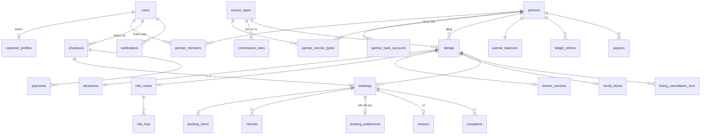

# LunaIn Travel — Thiết kế Database (PostgreSQL)

- Ngày: 2026-11-04
- Spec gốc: [2026-11-04-lunain-travel-backend-design.md](2026-11-04-lunain-travel-backend-design.md). Tài liệu này chi tiết hóa mục 5–9 của spec thành bảng, cột và ràng buộc. Chỗ nào hai tài liệu khác nhau thì spec gốc là chuẩn, và tài liệu này phải được sửa theo.
- Thuật ngữ: [GLOSSARY.md](../../../GLOSSARY.md)
- Ký hiệu: **[Chốt]** = đã có trong spec hoặc đã làm ở plan 1. **[Builder]** = quyết định thiết kế DB mới, cần chủ dự án xem.
- Trạng thái từng nhóm bảng: ✅ đã có (plan 1) · 🔜 plan sẽ làm (số plan theo [lộ trình](../plans/README.md))

---

## 1. Quy ước chung

| Mục | Quy ước |
|---|---|
| Khóa chính | `uuid` v7 sinh trong Go. Ngoại lệ: bảng danh mục dùng mã tự nhiên (`provinces.code`, `service_types.code`) |
| Thời gian | `timestamptz` (UTC). Ngày nghiệp vụ dùng `date`, giờ trong ngày dùng `time`, cả hai hiểu theo giờ `Asia/Ho_Chi_Minh` |
| Cột chuẩn | Mọi bảng có `created_at timestamptz NOT NULL DEFAULT now()` và `updated_at timestamptz NOT NULL DEFAULT now()`. Thời gian nghiệp vụ lấy từ clock của app, không dùng `now()` |
| Tiền | `bigint` VND (đồng). Số tiền bán ra `CHECK (x >= 0)`. Chỉ cột trong sổ cái mới có dấu |
| Tỷ lệ | Basis points `int CHECK (x BETWEEN 0 AND 10000)` (10% = 1000) |
| Enum | `text` + `CHECK (col IN (...))`, giống plan 1. Thêm giá trị bằng migration sửa CHECK, không dùng kiểu `ENUM` của Postgres vì khó đổi |
| Xóa | Không xóa cứng dữ liệu nghiệp vụ, chỉ đổi trạng thái. Ngoại lệ là dữ liệu xác thực (`user_identities` khi đặt lại mật khẩu) |
| Khóa ngoại | Có FK giữa các module để DB giữ toàn vẹn dữ liệu. Code của module chỉ đọc bảng của chính nó (spec §4). Không có `ON DELETE CASCADE` |
| Làm tròn **[Builder]** | `commission_amount = round_half_up(gross_amount × rate_bps / 10000)`, tương tự cho `refund_amount`. Tính bằng số nguyên trong Go, không dùng float |

### 1.1 Thứ tự khóa toàn hệ thống **[Builder]**

Plan 1 đã có quy tắc "user trước, dòng phụ thuộc sau". Khi một transaction chạm nhiều module thì luôn khóa theo thứ tự này, để không bao giờ deadlock:

```
users → partners → listings
      → dòng sức chứa: ride_trips / rental_vehicle_models (theo id tăng dần)
      → checkouts → bookings (theo id tăng dần)
      → dòng con của booking: booking_*_details, booking_settlements, refunds
      → payments → payouts → partner_balances (theo partner_id tăng dần)
```

- Dòng `users` khóa bằng `FOR NO KEY UPDATE`, để không chặn việc insert các bảng có FK trỏ về `users`.
- Khi tạo booking hoặc xác nhận lại do tiền về trễ, transaction phải lấy `FOR SHARE` trên dòng `partners` và `listings`. Nhờ vậy, một lệnh đình chỉ đối tác hoặc ẩn Listing commit cùng lúc sẽ được xếp hàng, không bị lọt booking.
- Dòng sức chứa đứng **trước** booking. Hủy chuyến, job hết hạn và tạo booking mới đều khóa chuyến hoặc mẫu xe trước. Nếu chỉ biết id booking thì đọc id của chuyến hoặc mẫu xe mà không khóa, khóa chuyến hoặc mẫu xe, rồi mới khóa booking và kiểm tra lại trạng thái.
- Dòng con của booking (`booking_settlements`, `refunds`, ...) chỉ được khóa sau khi đã khóa dòng `bookings`. Job giải phóng tiền cũng phải khóa booking trước.
- Các dòng khác khóa bằng `FOR UPDATE`.

### 1.2 Toàn vẹn chéo đối tác **[Builder]**

Để một lỗi ở app không thể gắn dữ liệu của đối tác này vào đối tác khác, DB tự ràng buộc bằng **khóa ngoại kép**:

- `listings` có `UNIQUE(id, partner_id)`. `bookings` có FK `(listing_id, partner_id) → listings(id, partner_id)` và `UNIQUE(id, partner_id)`.
- Mỗi bảng catalog con có `UNIQUE(id, listing_id)`: `attraction_ticket_types`, `attraction_time_slots`, `ride_trips`, `charter_vehicle_classes`, `rental_vehicle_models`, `rental_pickup_points`.
- Bảng chi tiết của booking có thêm `listing_id` và FK kép tới catalog con, ví dụ `booking_ride_details (trip_id, listing_id) → ride_trips(id, listing_id)`. Chiều về của khứ hồi là một booking riêng trên listing tuyến ngược, nên vẫn khớp.
- Các bảng mang `partner_id` cùng một booking (`booking_settlements`, `ledger_entries`, `reviews`, `complaints`) có FK `(booking_id, partner_id) → bookings(id, partner_id)`.

---

## 2. Sơ đồ quan hệ tổng quát



Bảng chi tiết theo từng loại dịch vụ (`attraction_*`, `ride_*`, `charter_*`, `rental_*`, `booking_*_details`) nằm ở mục 5 và mục 6.

---

## 3. Identity ✅ (plan 1)

Đã có trong migration `00002`–`00004`: `users`, `user_identities`, `email_verifications`, `refresh_tokens`, `customer_profiles`. Plan sau chỉ thêm một bảng:

| Bảng | Cột | Ghi chú |
|---|---|---|
| `customer_refund_accounts` 🔜 5 | `user_id` PK FK users, `bank_bin text`, `account_number text`, `account_holder text` | Tài khoản nhận hoàn khách lưu sẵn (spec §6.3) |

---

## 4. Nền tảng dùng chung 🔜 plan 2

### `platform_settings` **[Builder]**: các thông số Super Admin chỉnh được

Bảng chỉ có một dòng (`id smallint PRIMARY KEY CHECK (id = 1)`). Mỗi thông số là một cột có kiểu và CHECK riêng, không dùng dạng key–value, để DB tự chặn giá trị sai.

| Cột | Kiểu | Mặc định | Nguồn trong spec |
|---|---|---|---|
| `hold_minutes` | int > 0 | 15 | §6.1 |
| `hold_grace_minutes` | int ≥ 0 | 5 | §7 |
| `request_response_hours` | int > 0 | 12 | §6.2 |
| `request_payment_hours` | int > 0 | 2 | §6.2 |
| `charter_late_confirm_min_hours` | int ≥ 0 | 3 | §8 |
| `ride_checkin_window_minutes` | int > 0 | 60 | §10 (±X quanh giờ khởi hành) |
| `ride_no_show_after_minutes` | int ≥ 0 | 60 | §6.1 |
| `charter_auto_complete_hours` | int > 0 | 24 | §6.2 |
| `release_delay_days` | int ≥ 0 | 1 | §9 |
| `min_payout_amount` | bigint ≥ 0 | 100000 | §9 **[Builder]** chọn số |
| `reschedule_window_days` | int > 0 | 14 | §6.4 **[Chốt]** |

Mỗi lần đổi đều ghi vào `admin_audit_log`. Booking không trỏ tới bảng này mà chụp lại các mốc thời gian đã tính sẵn lúc tạo (`hold_expires_at`, ...), nên đổi thông số không ảnh hưởng đơn cũ.

### `holidays`: ngày lễ cho phụ phí xe bao chuyến
`date date PRIMARY KEY`, `name text NOT NULL`.

### `files`: mọi file tải lên (ảnh, giấy phép, chứng từ)
| Cột | Kiểu | Ghi chú |
|---|---|---|
| `id` | uuid PK | |
| `storage_key` | text UNIQUE NOT NULL | khóa trên object storage tương thích S3 |
| `content_type` | text NOT NULL | chỉ nhận ảnh và PDF, kiểm tra ở app |
| `size_bytes` | bigint > 0 | |
| `visibility` | `public` \| `private` | giấy phép và chứng từ luôn là `private` |
| `uploaded_by` | uuid FK users | |

### `admin_audit_log`
`id`, `actor_user_id` FK users, `action text` (ví dụ `commission_rate.create`, `listing.hide`), `target_kind text`, `target_id uuid`, `before jsonb`, `after jsonb`, `reason text`, `created_at`. Index `(target_kind, target_id, created_at DESC)`.

### Danh mục địa giới (spec §5.4)
- `provinces`: `code text PK` (mã chính thức), `name`, `slug UNIQUE`, `sort_order`.
- `wards`: `code text PK`, `province_code` FK, `name`, `slug`, `UNIQUE(province_code, slug)`.

Dữ liệu là 34 tỉnh/thành sau sáp nhập 2025, không còn cấp huyện. Import bằng một migration seed.

---

## 5. Partner và Catalog

### 5.1 Đối tác 🔜 plan 2

**`partners`**
| Cột | Kiểu | Ghi chú |
|---|---|---|
| `id` | uuid PK | |
| `legal_name` | text NOT NULL | tên trên giấy phép kinh doanh |
| `display_name` | text NOT NULL | tên hiển thị cho khách |
| `tax_code` | text NULL UNIQUE | đối tác tự cập nhật |
| `business_license_file_id` | uuid NULL FK files | file `private` |
| `address`, `province_code`, `ward_code` | | FK sang danh mục địa giới |
| `contact_name`, `contact_phone`, `contact_email` | text | |
| `status` | `active` \| `suspended` | **[Chốt]** spec §5.2 |
| `suspended_at`, `suspended_reason` | | |
| `rating_sum int`, `rating_count int` | ≥ 0 | điểm trung bình = sum/count, không lưu số thực |
| `created_by` | uuid FK users | Super Admin tạo |

- **`partner_members`**: `partner_id` FK, `user_id` FK **UNIQUE**, `role` (`owner`), PK `(partner_id, user_id)`. **[Builder]** Mỗi user thuộc tối đa một đối tác.
- **`partner_bank_accounts`**: `id`, `partner_id`, `bank_bin`, `bank_name`, `account_number`, `account_holder`, `is_current bool`, cùng unique index `(partner_id) WHERE is_current`. Đổi tài khoản thì thêm dòng mới và tắt `is_current` của dòng cũ, để giữ lịch sử.
- **`partner_service_types`**: PK `(partner_id, service_type)`, `enabled_by`, `enabled_at`, `disabled_at NULL`. **[Chốt]** Super Admin bật từng loại dịch vụ cho từng đối tác.

### 5.2 Loại dịch vụ và hoa hồng 🔜 plan 2

- **`service_types`**: `code text PK` (`attraction_ticket`, `scheduled_ride`, `private_charter`, `self_drive_rental`), `name`, `booking_mode` (`instant` \| `request`), `sort_order`. Seed bằng migration.
- **`commission_rates`**: `id`, `service_type` FK, `rate_bps` 0..10000, `effective_from timestamptz`, `created_by`, `UNIQUE(service_type, effective_from)`. Tỷ lệ đang áp dụng là dòng có `effective_from` lớn nhất mà ≤ thời điểm hiện tại. Không sửa dòng cũ.

### 5.3 Listing lớp chung 🔜 plan 3

**`listings`**
| Cột | Kiểu | Ghi chú |
|---|---|---|
| `id` | uuid PK | |
| `partner_id` | FK partners | |
| `service_type` | FK service_types | app kiểm tra loại này đã được bật cho đối tác |
| `title`, `slug` UNIQUE, `summary`, `description` | text | |
| `cover_file_id` | FK files NULL | |
| `province_code`, `ward_code`, `address` | | |
| `latitude`, `longitude` | `numeric(9,6)` NULL | |
| `review_status` | `draft` \| `pending_review` \| `approved` \| `rejected` | **[Chốt]** chỉ duyệt lần đầu |
| `rejection_reason`, `submitted_at`, `reviewed_at`, `reviewed_by` | | |
| `visibility` | `published` \| `unpublished_by_partner` \| `hidden_by_admin` | |
| `hidden_reason`, `hidden_at`, `hidden_by` | | |
| `rating_sum`, `rating_count` | int ≥ 0 | |

Index:
- `(partner_id)`
- index tìm kiếm cho khách: `(service_type, province_code) WHERE review_status = 'approved' AND visibility = 'published'`
- **[Builder]** index trigram `pg_trgm` trên `lower(unaccent(title))` để tìm không dấu. `unaccent` không phải hàm IMMUTABLE, nên bọc trong một hàm wrapper IMMUTABLE.

Bảng phụ:
- **`listing_images`**: `id`, `listing_id`, `file_id`, `sort_order`, `UNIQUE(listing_id, sort_order)`.
- **`listing_cancellation_tiers`** **[Builder]**: các mốc gắn thẳng vào listing, không cần bảng "policy" trung gian. Cột: `id`, `listing_id`, `hours_before int ≥ 0`, `refund_bps` 0..10000, `UNIQUE(listing_id, hours_before)`. Booking chụp lại toàn bộ các mốc vào `cancellation_policy_snapshot`.
- **`listing_audit_log`**: `id`, `listing_id`, `actor_user_id`, `action`, `changes jsonb` (`{field: {old, new}}`), `created_at`. **[Chốt]** spec §5.4.

### 5.4 Vé tham quan 🔜 plan 3

| Bảng | Cột chính | Ràng buộc |
|---|---|---|
| `attractions` | `listing_id` PK FK, `opening_note`, `checkin_instructions` | 1-1 với listing |
| `attraction_ticket_types` | `id`, `listing_id`, `name`, `description`, `audience` (`child`\|`adult`), `price bigint > 0`, `active`, `sort_order` | **[Chốt]** đối tác tự đặt tên và giá |
| `attraction_time_slots` | `id`, `listing_id`, `start_time time`, `end_time time`, `weekdays smallint`, `active` | `end_time > start_time`. `weekdays` là bitmask 1..127 (bit 0 = thứ Hai) **[Builder]** |
| `attraction_closed_dates` | PK `(listing_id, date)`, `reason` | |

### 5.5 Xe tuyến cố định 🔜 plan 6

**[Builder]** Mỗi listing là **một tuyến một chiều** A→B, đúng theo glossary. Chiều về B→A là một listing khác của cùng nhà xe. Khi đặt khứ hồi, khách chọn chuyến về từ listing tuyến ngược lại.

| Bảng | Cột chính | Ràng buộc |
|---|---|---|
| `ride_routes` | `listing_id` PK, `origin_province_code`, `origin_ward_code`, `origin_name`, `origin_address`, `dest_*` (tương tự), `duration_minutes > 0`, `vehicle_description` | |
| `ride_schedules` | `id`, `listing_id`, `departure_time time`, `weekdays smallint`, `seat_capacity > 0`, `price_per_seat > 0`, `valid_from date`, `valid_to date NULL`, `active` | lịch lặp để sinh chuyến |
| `ride_trips` | `id`, `listing_id`, `schedule_id NULL`, `departure_at timestamptz`, `seat_capacity int > 0`, `seats_reserved int`, `price_per_seat`, `status` (`scheduled`\|`cancelled`\|`departed`), `cancelled_reason` | `CHECK (seats_reserved BETWEEN 0 AND seat_capacity)`, `UNIQUE(listing_id, departure_at)`, index `(listing_id, departure_at)` |

Giữ ghế dùng lệnh `UPDATE ride_trips SET seats_reserved = seats_reserved + n WHERE id = $1 AND status = 'scheduled' AND departure_at > $now AND seats_reserved + n <= seat_capacity` (spec §7). Không bán ghế cho chuyến đã hủy hoặc đã chạy.

Trước khi giữ ghế, transaction đã khóa chuyến **[Builder]**. Ngay lúc đó nó nhả luôn ghế của các booking trên chuyến này đã quá `hold_release_at` mà job chưa quét tới. Spec §7 yêu cầu đơn quá hạn không được chiếm chỗ, mà bộ đếm `seats_reserved` không tự bỏ qua được đơn quá hạn, nên phải nhả ngay trong transaction.

**[Builder]** Một trigger chặn sửa `departure_at` và `price_per_seat` khi `seats_reserved > 0`. Đối tác không đổi được giờ của chuyến đã có người đặt, phù hợp với quy tắc đối tác không hủy được đơn đã xác nhận. Muốn đổi thì nhờ Super Admin hủy chuyến.

### 5.6 Xe bao chuyến 🔜 plan 8

| Bảng | Cột chính |
|---|---|
| `charter_services` | `listing_id` PK, `max_distance_km numeric(7,1) NULL`, `night_start time NULL`, `night_end time NULL` |
| `charter_service_areas` | PK `(listing_id, province_code)` |
| `charter_vehicle_classes` | `id`, `listing_id`, `name`, `seats > 0`, `base_fare ≥ 0`, `price_per_km ≥ 0`, `active` |
| `charter_surcharges` | `id`, `vehicle_class_id`, `kind` (`night`\|`weekend`\|`holiday`\|`round_trip_waiting`), `calc` (`fixed`\|`percent`), `amount bigint ≥ 0` (VND nếu `fixed`, bps nếu `percent`), `active`, `UNIQUE(vehicle_class_id, kind)` |

**[Chốt]** Phụ phí nào không có dòng thì bằng 0đ.

### 5.7 Thuê xe tự lái 🔜 plan 7

| Bảng | Cột chính |
|---|---|
| `rental_stores` | `listing_id` PK, `handover_open time`, `handover_close time`, `delivery_available bool`, và các điều khoản dạng text: `deposit_terms`, `documents_terms`, `late_fee_terms`, `allowed_area_terms`, `other_terms` |
| `rental_vehicle_models` | `id`, `listing_id`, `vehicle_kind` (`car`\|`motorbike`), `name`, `model_year smallint`, `seats`, `included_items text`, `tags text[]`, `price_per_day > 0`, `quantity int ≥ 0`, `cover_file_id`, `active` |
| `rental_pickup_points` | `id`, `listing_id`, `name`, `address`, `ward_code`, `delivery_fee bigint ≥ 0`, `active` |

---

## 6. Booking 🔜 plan 4 (lớp chung + vé tham quan), plan 6–8 (các loại xe)

### `checkouts`: một lần khách thanh toán
| Cột | Kiểu | Ghi chú |
|---|---|---|
| `id` | uuid PK | |
| `customer_id` | FK users | |
| `total_amount` | bigint ≥ 0 | = tổng `gross_amount` của các booking trong checkout |
| `status` | `open` \| `paid` \| `closed` | `closed` khi mọi booking của nó đã hết hạn hoặc bị từ chối mà chưa thanh toán |

**[Builder]** Checkout được tạo cùng lúc với booking cho mọi loại dịch vụ. Với Request Booking thì chỉ tạo payment khi đối tác đã chấp nhận.

### `bookings`
| Cột | Kiểu | Ghi chú |
|---|---|---|
| `id` | uuid PK | |
| `code` | text UNIQUE | **[Builder]** dạng `LT` + 8 ký tự Crockford base32 (ví dụ `LT7K3M9QX2`) |
| `checkout_id`, `customer_id`, `partner_id`, `listing_id` | FK | |
| `service_type`, `booking_mode` | | chụp lại lúc đặt |
| `status` | xem bên dưới | |
| `service_start_at`, `service_end_at` | timestamptz | `end ≥ start` |
| `original_service_start_at` | timestamptz | **[Chốt]** % hoàn sau khi đổi lịch tính theo mốc này |
| `gross_amount`, `commission_rate_bps`, `commission_amount` | | **[Chốt]** chụp lại lúc đặt. `CHECK (commission_amount BETWEEN 0 AND gross_amount)` |
| `cancellation_policy_snapshot` | jsonb NOT NULL | `[{hours_before, refund_bps}]` |
| `contact_name`, `contact_phone`, `contact_email`, `customer_note` | | |
| `hold_expires_at` | timestamptz NULL | mốc khách thấy |
| `hold_release_at` | timestamptz NULL | = `hold_expires_at` + thời gian đệm, là mốc nhả chỗ thật |
| `response_due_at`, `payment_due_at` | NULL | chỉ dùng cho Request Booking |
| `accepted_at`, `rejected_at`, `reject_reason` | | |
| `confirmed_at`, `checked_in_at`, `in_service_at`, `completed_at`, `no_show_at` | | |
| `cancelled_at`, `cancel_kind` (`customer`\|`customer_withdraw`\|`admin_force_majeure`\|`admin_policy`), `cancel_reason`, `cancelled_by` | | `customer_withdraw` là khách rút Request Booking trước khi trả tiền |
| `qr_token` | text UNIQUE NOT NULL | 32 byte ngẫu nhiên, mã hóa base64url **[Builder]** lưu nguyên văn vì khách cần xem lại QR. Token chỉ dùng để check-in, không mở được dữ liệu nào khác |

**Mốc thời gian theo loại dịch vụ** **[Builder]**. Các job No-show, tự hoàn thành và giải phóng tiền đều chạy theo các mốc này:

| Loại | `service_start_at` | `service_end_at` | Chuyển trạng thái cuối |
|---|---|---|---|
| Attraction | ngày tham quan + giờ bắt đầu khung | 23:59:59 của ngày tham quan (giờ VN) | check-in → `completed` ngay. Qua `service_end_at` mà chưa check-in → `no_show` |
| Scheduled Ride | `departure_at` | `departure_at` + `duration_minutes` | qua `departure_at` + `ride_no_show_after_minutes` mà chưa check-in → `no_show`. Đã check-in → job chuyển `completed` khi qua `service_end_at` |
| Private Charter | `pickup_at` | `return_at` nếu đi khứ hồi, nếu không thì `pickup_at` + thời gian chạy ước tính từ API bản đồ | đối tác bấm hoàn thành, hoặc job tự hoàn thành sau `service_end_at` + `charter_auto_complete_hours` |
| Self-Drive Rental | `pickup_at` | `return_at` | đối tác bấm "đã nhận lại xe" → `completed` |

Index của job No-show dùng `service_start_at` cho Scheduled Ride, vì mốc No-show của xe tuyến tính theo giờ khởi hành.

**Super Admin hủy đơn** **[Builder]**: chỉ hủy được khi dịch vụ chưa diễn ra, tức đơn đang `confirmed` (hoặc trước đó). Đơn đã `checked_in`, `in_service`, `completed` hay `no_show` thì không hủy được. Spec đã chốt không có hoàn tiền ngoài chính sách hủy, nên sổ cái không cần xử lý trường hợp hoàn tiền sau khi tiền đã được giải phóng.

**Vé khứ hồi hủy cùng nhau** **[Chốt]**: hủy là hủy theo cả `checkout`. Transaction khóa cả hai chuyến (theo id tăng dần), rồi khóa cả hai booking (theo id tăng dần), sau đó hủy cả hai. Khách chỉ hủy được khi chưa đi chiều nào.

**Thanh toán sai số tiền** **[Builder]**: mã QR của PayOS đã gắn sẵn số tiền nên hiếm khi xảy ra, nhưng vẫn có các trường hợp sau: khách quét mã hai lần (trả trùng), khách tự chuyển khoản tay vào số tài khoản với nội dung là mã đơn, hoặc tiền về sau khi đơn đã hết hạn. Hệ thống xử lý tự động như sau:
- **Trả trùng**: lần thứ hai được hoàn 100% (`refunds.reason = duplicate_payment`).
- **Chuyển thiếu**: không xác nhận đơn, hoàn lại toàn bộ (`payment_mismatch`).
- **Chuyển thừa**: xác nhận đơn, hoàn lại phần thừa. Khoản hoàn này gắn với payment (`booking_id = NULL`, `reason = payment_mismatch`), nên nếu sau đó khách hủy đơn thì vẫn tạo được khoản hoàn theo chính sách hủy.

Cả ba trường hợp đều đánh dấu `payments.status = needs_review` để Super Admin nhìn thấy.

**Super Admin tắt một loại dịch vụ của đối tác** **[Builder]**: xử lý giống đình chỉ nhưng chỉ trong loại đó. Listing thuộc loại đó bị ẩn với khách và không nhận đơn mới. Đơn đã có vẫn phục vụ bình thường.

`status` gồm `requested`, `awaiting_payment`, `pending_payment`, `confirmed`, `checked_in`, `in_service`, `completed`, `no_show`, `cancelled`, `expired`, `rejected`. Thêm `CHECK` ràng buộc `booking_mode`: `requested`, `awaiting_payment` và `rejected` chỉ có ở Request Booking, còn `pending_payment` và `checked_in` chỉ có ở Instant Booking.

Index cho job nền (partial index để nhỏ và nhanh):
- `(hold_release_at) WHERE status IN ('pending_payment','awaiting_payment')`: hết hạn giữ chỗ
- `(response_due_at) WHERE status = 'requested'`: đối tác quá hạn phản hồi
- `(service_end_at) WHERE status IN ('confirmed','checked_in','in_service')`: No-show của vé tham quan và tự hoàn thành
- `(service_start_at) WHERE status = 'confirmed' AND service_type = 'scheduled_ride'`: No-show của xe tuyến
- `(customer_id, created_at DESC)` và `(partner_id, status, service_start_at)`: màn danh sách đơn

### Các bảng phụ của booking
| Bảng | Cột chính | Ghi chú |
|---|---|---|
| `booking_items` | `id`, `booking_id`, `line_kind` (`ticket`\|`seat`\|`charter_base`\|`charter_distance`\|`surcharge`\|`rental_day`\|`delivery_fee`), `description`, `unit_price ≥ 0`, `quantity numeric(10,1) > 0`, `line_total` | `CHECK (line_total = round(unit_price * quantity))`. `round` của Postgres làm tròn nửa lên với số dương, khớp quy ước ở mục 1. Quãng đường đi vào `quantity` (12,3 km), khứ hồi tính 2 lần quãng đường. Phụ phí theo % thì `unit_price` là số tiền đã tính và `quantity` là 1. App kiểm tra tổng các dòng = `gross_amount` (có test) |
| `booking_ticket_lines` | `booking_item_id` PK FK, `ticket_type_id` FK | loại vé của từng dòng |
| `booking_attraction_details` | `booking_id` PK, `visit_date date`, `time_slot_id`, `slot_start time`, `slot_end time` | chụp lại giờ của khung |
| `booking_ride_details` | `booking_id` PK, `listing_id`, `trip_id`, `seats int > 0`, `direction` (`outbound`\|`return`) | FK `(trip_id, listing_id) → ride_trips(id, listing_id)`, index `(trip_id)` |
| `booking_charter_details` | `booking_id` PK, `vehicle_class_id`, `pickup_at`, `pickup_address`, `pickup_lat/lng`, `dropoff_address`, `dropoff_lat/lng`, `distance_km numeric(7,1)`, `is_round_trip`, `return_at NULL`, `quote jsonb` | `quote` chụp lại toàn bộ cách tính giá |
| `booking_rental_details` | `booking_id` PK, `listing_id`, `vehicle_model_id`, `pickup_at`, `return_at`, `period tstzrange GENERATED ALWAYS AS (tstzrange(pickup_at, return_at, '[)')) STORED`, `days int > 0`, `pickup_point_id NULL`, `delivery_address NULL`, `holds_vehicle bool`, `hold_until timestamptz NULL` | xem ghi chú bên dưới |
| `booking_status_history` | `id`, `booking_id`, `from_status`, `to_status`, `actor_kind` (`customer`\|`partner`\|`admin`\|`system`), `actor_user_id NULL`, `reason`, `created_at` | index `(booking_id, created_at)` |
| `booking_reschedules` | `id`, `booking_id` **UNIQUE**, `from_visit_date`, `from_slot_id`, `to_visit_date`, `to_slot_id`, `created_by`, `created_at` | **[Builder]** dùng `UNIQUE` để DB tự chặn đổi lịch quá 1 lần. Không cần cột `reschedule_count` |
| `idempotency_keys` | PK `(user_id, key)`, `endpoint`, `request_hash bytea`, `response_status`, `response_body jsonb`, `created_at` | spec §7. Job dọn các dòng quá 24 giờ |

**Giữ xe thuê** **[Builder]**: `holds_vehicle` bằng `true` khi đơn ở `requested`, `awaiting_payment`, `confirmed` hoặc `in_service`. Cột này được cập nhật trong **cùng transaction** với lần đổi trạng thái. Lý do: index GiST cần một cột nằm ngay trên chính bảng này:
```sql
CREATE INDEX ON booking_rental_details USING gist (vehicle_model_id, period) WHERE holds_vehicle;
```
Kết hợp với việc khóa dòng `rental_vehicle_models` (spec §7), phép đếm số xe đã giữ trùng khoảng thời gian chạy nhanh và đúng. Index cần extension `btree_gist`, đã bật ở migration `00001`.

`hold_until` lưu hạn của đơn chưa được xác nhận: `response_due_at` khi đơn đang `requested`, hoặc `payment_due_at` + thời gian đệm khi đang `awaiting_payment`. Khi đơn đã `confirmed` thì cột này là NULL. Phép đếm dùng điều kiện `holds_vehicle AND (hold_until IS NULL OR hold_until > $now)`, nên đơn quá hạn mà job chưa quét không chiếm xe oan. Khi tiền về trễ và đơn được xác nhận lại, hệ thống đặt lại `holds_vehicle` và `hold_until`.

---

## 7. Payment 🔜 plan 4

| Bảng | Cột chính | Ràng buộc |
|---|---|---|
| `payments` | `id`, `checkout_id` FK, `provider` (`payos`), `provider_order_code bigint UNIQUE`, `amount > 0`, `status` (`pending`\|`paid`\|`expired`\|`cancelled`\|`needs_review`), `checkout_url`, `qr_code`, `expires_at`, `paid_at`, `provider_reference`, `raw jsonb` | unique index `(checkout_id) WHERE status = 'pending'`: mỗi checkout chỉ có một link đang chờ. `needs_review` dùng khi số tiền không khớp (spec §8) |
| `payment_events` | `id`, `payment_id NULL`, `provider`, `dedupe_key text UNIQUE`, `signature_valid bool`, `payload jsonb`, `received_at`, `processed_at NULL`, `result text` | webhook gọi lặp thì bị chặn ở `dedupe_key` |
| `refunds` | `id`, `payment_id` FK **NOT NULL**, `booking_id` FK **NULL**, `amount > 0`, `reason` (`customer_cancel`\|`admin_cancel`\|`late_payment`\|`payment_mismatch`\|`duplicate_payment`), `status` (`awaiting_bank_info`\|`pending`\|`completed`), `bank_bin`, `account_number`, `account_holder`, `transfer_reference`, `proof_file_id`, `completed_by`, `completed_at` | `CHECK (status <> 'completed' OR transfer_reference IS NOT NULL)`. Unique `(booking_id) WHERE booking_id IS NOT NULL`: mỗi booking tối đa một khoản hoàn, nên webhook và job đối soát không thể cùng tạo hai lần. Khoản hoàn không gắn booking (thanh toán thừa, trùng hoặc lệch tiền) thì unique `(payment_id) WHERE booking_id IS NULL`. Index `(status)` |
| `payment_reconciliations` | `id`, `run_date date UNIQUE`, `status` (`ok`\|`mismatch`), `mismatches jsonb` | đối soát hằng ngày (spec §8) |

---

## 8. Ledger và Payout 🔜 plan 4 (bút toán), plan 5 (payout)

### `partner_balances`
`partner_id` PK FK, `pending bigint`, `available bigint` (cả hai có thể âm), `last_seq bigint NOT NULL DEFAULT 0`, `updated_at`. Đây là bản cache, cập nhật cùng transaction với bút toán. `last_seq` dùng để cấp số thứ tự cho bút toán (xem bên dưới).

### `ledger_entries`: bất biến, chỉ insert
| Cột | Kiểu | Ghi chú |
|---|---|---|
| `id` | uuid PK | |
| `partner_id` | FK | |
| `seq` | bigint NOT NULL | **[Builder]** số thứ tự liên tục theo đối tác, cấp từ `partner_balances.last_seq + 1` khi đang giữ khóa dòng `partner_balances`. `UNIQUE(partner_id, seq)` |
| `available_after` | bigint NOT NULL | số dư khả dụng ngay sau bút toán này, để đối chiếu từng dòng |
| `booking_id` / `payout_id` | NULL | |
| `kind` | `booking_earning` \| `refund_debit` \| `commission_waiver` \| `release` \| `payout_hold` \| `payout_reversal` \| `adjustment` | spec §9 |
| `bucket` | `pending` \| `available` | |
| `amount` | bigint **có dấu**, `<> 0` | khoản bằng 0 thì không ghi |
| `reason`, `created_by NULL`, `created_at` | | |

Ràng buộc:
- `CHECK`: các kind theo booking thì `booking_id NOT NULL`; các kind payout thì `payout_id NOT NULL`; `adjustment` thì `reason` và `created_by NOT NULL`.
- Unique index `(booking_id, kind, bucket) WHERE kind IN ('booking_earning','refund_debit','commission_waiver','release')`: mỗi booking ghi mỗi loại bút toán đúng một lần, giải phóng tiền đúng một lần. Bút toán `adjustment` không nằm trong index này, nên một booking có thể được điều chỉnh nhiều lần.
- Unique index `(payout_id, kind) WHERE kind IN ('payout_hold','payout_reversal')`: một yêu cầu rút không thể giữ hoặc hoàn tiền hai lần.
- Sao kê và đối soát đi theo `seq`, không theo `created_at`. Thời gian `created_at` lấy từ clock trước khi commit, nên một bút toán commit trễ có thể mang mốc giờ nằm trong một kỳ đã chốt. `seq` được cấp khi đang giữ khóa nên không bao giờ lọt.
- **[Builder]** Một trigger `BEFORE UPDATE OR DELETE` luôn raise exception, để DB chặn việc sửa sổ cái.

### `booking_settlements` **[Builder]**: theo dõi tiền của từng booking
`booking_id` PK, `partner_id`, `net_pending bigint` (phần còn nằm ở `pending`), `release_due_at timestamptz NULL`, `released_at NULL`. Index `(release_due_at) WHERE released_at IS NULL`. Job giải phóng tiền quét theo index này.

### `platform_commission_entries`: doanh thu sàn
`id`, `booking_id`, `service_type`, `kind` (`commission` \| `waiver`), `amount` có dấu, `created_at`, `UNIQUE(booking_id, kind)`.

### `payouts`
| Cột | Ghi chú |
|---|---|
| `id`, `partner_id`, `amount > 0` | |
| `status` | `requested` \| `approved` \| `paid` \| `rejected` |
| `bank_bin`, `bank_name`, `account_number`, `account_holder` | chụp lại lúc đối tác yêu cầu |
| `statement_seq_from`, `statement_seq_to` bigint | khoảng `seq` của sao kê (spec §9): từ ngay sau bút toán cuối của payout trước, tới bút toán `payout_hold` của chính payout này |
| `opening_available`, `closing_available` | số dư đầu kỳ và cuối kỳ, lấy từ `available_after` |
| `requested_by/at`, `approved_by/at`, `paid_by/at`, `transfer_reference`, `proof_file_id`, `rejected_by/at`, `reject_reason` | |

Unique index `(partner_id) WHERE status IN ('requested','approved')`: **[Chốt]** mỗi đối tác chỉ có một yêu cầu rút đang mở.

---

## 9. Review, Complaint, Notification 🔜 plan 9

| Bảng | Cột chính | Ràng buộc |
|---|---|---|
| `reviews` | `id`, `booking_id` **UNIQUE**, `listing_id`, `partner_id`, `customer_id`, `rating smallint 1..5`, `comment`, `status` (`visible`\|`hidden_by_admin`), `hidden_reason`, `partner_reply`, `partner_replied_at` | **[Chốt]** mỗi booking tối đa một review. App kiểm tra booking đã `completed` |
| `review_images` | `review_id`, `file_id`, `sort_order` | |
| `complaints` | `id`, `booking_id`, `listing_id`, `partner_id`, `customer_id`, `category`, `content`, `status` (`open`\|`in_progress`\|`resolved`\|`rejected`), `partner_response`, `admin_note`, `resolved_by`, `resolved_at` | index `(listing_id, status)` |
| `complaint_images` | `complaint_id`, `file_id`, `sort_order` | |
| `notifications` | `id`, `user_id`, `type`, `title`, `body`, `link`, `data jsonb`, `read_at NULL`, `created_at` | index `(user_id, created_at DESC)` và `(user_id) WHERE read_at IS NULL` |

Email không có bảng riêng, chạy qua job River (outbox) như plan 1.

---

## 10. Bất biến mà DB tự giữ

| Bất biến | Cách giữ |
|---|---|
| Không bán quá số ghế | `CHECK (seats_reserved BETWEEN 0 AND seat_capacity)` cùng lệnh UPDATE có điều kiện |
| Không cho thuê quá số xe | khóa dòng mẫu xe + index GiST + đếm trong transaction (app) |
| Thanh toán không bị ghi hai lần | `payment_events.dedupe_key UNIQUE`, `payments.provider_order_code UNIQUE` |
| Mỗi booking chỉ giải phóng tiền một lần | unique index `(booking_id, kind, bucket)` (theo các kind của booking) trên `ledger_entries` |
| Payout không giữ hoặc hoàn tiền hai lần | unique index `(payout_id, kind)` |
| Sao kê không lọt bút toán | `ledger_entries.seq` liên tục theo đối tác, cấp khi giữ khóa |
| Mỗi booking tối đa một khoản hoàn | unique index partial trên `refunds` |
| Dữ liệu không bị gắn nhầm đối tác | khóa ngoại kép (mục 1.2) |
| Không bán ghế cho chuyến đã hủy hoặc đã chạy | điều kiện `status` và `departure_at` trong lệnh UPDATE giữ ghế |
| Sổ cái không bị sửa | trigger chặn UPDATE và DELETE |
| Đổi lịch tối đa 1 lần | `booking_reschedules.booking_id UNIQUE` |
| Tối đa 1 review mỗi đơn | `reviews.booking_id UNIQUE` |
| 1 payout đang mở mỗi đối tác | unique index partial trên `payouts` |
| Hoa hồng không vượt giá trị đơn | `CHECK` trên `bookings` |

Những bất biến DB không tự giữ được (tổng các dòng = `gross_amount`, cache số dư = tổng bút toán) thì có test ở app, và có thêm job đối soát (spec §9).

---

## 11. Migration và sqlc

- Mọi migration nằm ở `internal/platform/db/migrations`, đánh số liên tục. Mỗi plan thêm file mới và không sửa file cũ.
- **[Builder]** Mỗi module có một mục riêng trong `sqlc.yaml`. Schema vẫn trỏ vào toàn bộ thư mục migration (sqlc cần đủ schema để kiểm tra FK), nhưng code chỉ được gọi query của chính module mình. Quy tắc này nằm trong code review vì sqlc không tự chặn được.
- Seed (danh mục địa giới, `service_types`, `platform_settings`, `commission_rates` ban đầu) đi bằng migration, để môi trường nào cũng giống nhau.
